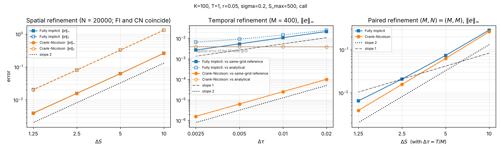
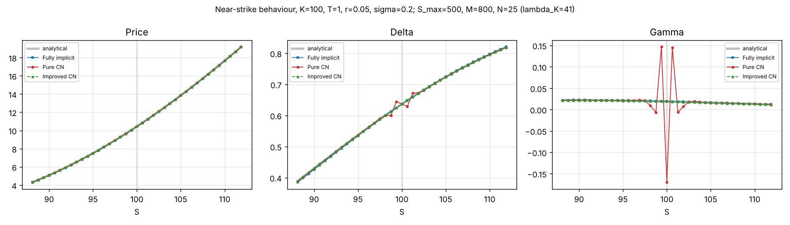

# Numerical Solution of the Black–Scholes Equation by Finite Differences

European call and put options priced by solving the Black–Scholes PDE with **fully implicit** and **Crank–Nicolson** finite-difference schemes, implemented from first principles in Python (own grid, boundary treatment and Thomas tridiagonal solver). The numerical solutions are verified against the analytical Black–Scholes formula, their spatial and temporal convergence orders are measured independently, numerical Delta and Gamma are analysed, and the Crank–Nicolson oscillations caused by the payoff kink are investigated and removed with an implicit (Rannacher) start-up.

*Project 3 — Numerical Methods in Computational Finance, Department of Mathematics, BITS Pilani, Hyderabad Campus. Principal reference: D. J. Duffy, *Numerical Methods in Computational Finance: A PDE/FDM Approach*, Wiley, 2022.*

---

## The problem

With time to maturity $\tau = T - t$, the option value $V(S,\tau)$ satisfies

$$
\frac{\partial V}{\partial \tau} = \frac{1}{2}\sigma^2 S^2 \frac{\partial^2 V}{\partial S^2} + r S \frac{\partial V}{\partial S} - r V, \qquad 0 < S < S_{\max},\ 0 < \tau \le T,
$$

$$
V(S,0) = \max(S-K,0)\ \text{(call)}, \qquad V(S,0) = \max(K-S,0)\ \text{(put)},
$$

$$
\text{call: } V(0,\tau) = 0,\ \ V(S_{\max},\tau) = S_{\max} - Ke^{-r\tau}; \qquad
\text{put: } V(0,\tau) = Ke^{-r\tau},\ \ V(S_{\max},\tau) = 0 .
$$

On the grid $S_j = j\Delta S$, $\tau_n = n\Delta\tau$ the operator becomes $\mathcal{L}_h V_j = \alpha_j V_{j-1} + \beta_j V_j + \gamma_j V_{j+1}$ with
$\alpha_j = \tfrac12(\sigma^2 j^2 - rj)$, $\beta_j = -(\sigma^2 j^2 + r)$, $\gamma_j = \tfrac12(\sigma^2 j^2 + rj)$, and the θ-scheme

$$
\frac{V_j^{n+1} - V_j^n}{\Delta\tau} = \theta\,\mathcal{L}_h V_j^{n+1} + (1-\theta)\,\mathcal{L}_h V_j^n
$$

gives one tridiagonal system per time step: $\theta = 1$ fully implicit, $\theta = \tfrac12$ Crank–Nicolson.

---

## Benchmark

| Parameter | Value |
|---|---|
| Strike $K$ | 100 |
| Maturity $T$ | 1 year |
| Risk-free rate $r$ | 0.05 |
| Volatility $\sigma$ | 0.20 |
| Evaluation point | $S = K = 100$ |

Analytical reference values (`programs/black_scholes.py`): call **10.450584**, put **5.573526**, call Delta **0.636831**, put Delta **−0.363169**, Gamma **0.018762**.

**Numerical assumption.** The domain is truncated at $S_{\max} = 5K = 500$. The domain-truncation study ($S_{\max} = 2K,3K,4K,5K$) shows the price at $S = K$ changes by less than $10^{-11}$, so truncation is negligible; $5K$ is chosen because it is conservative and places $K$ on a grid node for every $M \in \{50,100,200,400\}$ ([Part 6, §6.8](derivations/06_convergence_analysis.md#68-domain-truncation)).

---

## Key results (all produced by the programs in this repository)

**Prices at $S = K$** ($M = N = 400$, $\Delta S = 1.25$, $\Delta\tau = 0.0025$)

| | Analytical | Fully implicit | error | Crank–Nicolson | error |
|---|---:|---:|---:|---:|---:|
| Call | 10.450584 | 10.444095 | −6.5e-03 | 10.446723 | −3.9e-03 |
| Put | 5.573526 | 5.567335 | −6.2e-03 | 5.569665 | −3.9e-03 |

**Observed convergence orders** (finest refinement step; $p = \log(E_h/E_{h/2})/\log 2$)

| Method | space ($M = 50 \to 400$) | time ($N = 50 \to 400$) | theory (time / space) |
|---|:---:|:---:|:---:|
| Fully implicit | 1.99 | 1.00 | 1 / 2 |
| Crank–Nicolson | 2.00 | 2.00 | 2 / 2 |

**Greeks at $S = K$** (Crank–Nicolson, $M = N = 400$): Delta 0.636733 (error 9.8e-05), Gamma 0.018773 (error 1.1e-05); both converge at second order in $\Delta S$.

**Payoff kink** ($M = 800$, $N = 25$, $\lambda_K = \sigma^2K^2\Delta\tau/\Delta S^2 = 41$): pure Crank–Nicolson gives $\Gamma(K) = -0.170$ (exact 0.0188) with 8 spurious extrema; the improved CN with two implicit half-steps gives $\Gamma(K) = 0.0190$, no oscillation, and the smallest price error of the three methods.

<p align="center"></p>
<p align="center"></p>

---

## Mathematical derivations

Each part states the problem, defines all symbols and assumptions, derives the scheme step by step, and links the final equations to the code and to the numerical results.

| Part | Topic | Program |
|---|---|---|
| [1](derivations/01_finite_difference_approximations.md) | Finite-difference approximations from Taylor series; the computational grid | `finite_difference_derivatives.py`, `generate_grid.py` |
| [2](derivations/02_black_scholes_pde_discretisation.md) | Black–Scholes problem, time reversal, payoffs, boundary conditions, analytical solution, discrete operator, θ-scheme | `black_scholes.py`, `generate_grid.py` |
| [3](derivations/03_thomas_algorithm.md) | Tridiagonal systems and the Thomas algorithm; diagonal dominance | `thomas_solver.py` |
| [4](derivations/04_fully_implicit_method.md) | Fully implicit (backward Euler) method: matrix, boundaries, accuracy, stability | `implicit_fdm.py` |
| [5](derivations/05_crank_nicolson_method.md) | Crank–Nicolson method: $A V^{n+1} = BV^n + g$, accuracy, A- vs L-stability | `crank_nicolson.py` |
| [6](derivations/06_convergence_analysis.md) | Consistency, stability, convergence; independent spatial / temporal / paired refinement; domain truncation | `convergence_study.py` |
| [7](derivations/07_numerical_greeks.md) | Numerical Delta and Gamma; error amplification; mesh refinement; strike alignment | `numerical_greeks.py` |
| [8](derivations/08_payoff_kink_and_cn_oscillations.md) | Payoff kink, Crank–Nicolson oscillations, implicit (Rannacher) start-up | `payoff_kink_cn_oscillation.py` |

---

## Repository structure

```
numerical-black-scholes-fdm/
├── README.md
├── requirements.txt
├── reproduce_all_results.py          run every program; text output -> results/, plots -> figures/
├── derivations/                      Parts 1-8 (Markdown + LaTeX)
├── programs/
│   ├── parameters.py                 benchmark (K, T, r, sigma) and S_max = 5K, in one place
│   ├── black_scholes.py              analytical price, Delta, Gamma
│   ├── finite_difference_derivatives.py   Part 1: Taylor stencils and their orders
│   ├── generate_grid.py              grid, payoff, boundary values (+ checks)
│   ├── thomas_solver.py              Thomas algorithm (+ verification vs exact / NumPy)
│   ├── implicit_fdm.py               fully implicit solver
│   ├── crank_nicolson.py             Crank-Nicolson solver, optional implicit start-up
│   ├── convergence_study.py          verification, refinement studies, domain truncation
│   ├── numerical_greeks.py           Delta / Gamma analysis
│   └── payoff_kink_cn_oscillation.py kink, oscillations, improved CN
├── results/                          text output of each program (01-09)
└── figures/                          fig01-fig10, written by the programs themselves
```

| Figure | Content | Written by |
|---|---|---|
| `fig01_fd_truncation_error.png` | orders of the finite-difference formulas | `finite_difference_derivatives.py` |
| `fig02_payoffs.png` | call and put payoffs, kink at $K$ | `generate_grid.py` |
| `fig03_implicit_price_and_error.png` | fully implicit vs analytical price, pointwise error | `implicit_fdm.py` |
| `fig04_crank_nicolson_price_and_error.png` | Crank–Nicolson vs analytical price, pointwise error | `crank_nicolson.py` |
| `fig05_convergence.png` | spatial, temporal and paired refinement (log–log) | `convergence_study.py` |
| `fig06_pointwise_error_refinement.png` | error profiles under refinement | `convergence_study.py` |
| `fig07_numerical_greeks.png` | numerical vs analytical Delta and Gamma, magnified near $K$ | `numerical_greeks.py` |
| `fig08_greek_convergence.png` | price / Delta / Gamma error vs $\Delta S$ | `numerical_greeks.py` |
| `fig09_kink_price_delta_gamma.png` | implicit vs pure CN vs improved CN near the strike | `payoff_kink_cn_oscillation.py` |
| `fig10_kink_refinement.png` | effect of $\Delta S$ and $\Delta\tau$ on CN oscillations | `payoff_kink_cn_oscillation.py` |

---

## Running the code

Requirements: Python 3.9+ with NumPy and Matplotlib.

```bash
pip install -r requirements.txt

python reproduce_all_results.py          # everything (about 30 s); writes results/ and figures/
```

Individual programs are run from the `programs/` folder. Every solver program accepts the model and grid parameters, so the benchmark can be changed without editing code:

```bash
cd programs
python black_scholes.py                                   # analytical benchmark
python implicit_fdm.py                                    # S_max = 5K, M = N = 400
python crank_nicolson.py --M 800 --N 100                  # finer space grid
python crank_nicolson.py --M 800 --N 25 --startup 1       # improved CN
python crank_nicolson.py --sigma 0.3 --T 0.5               # any other parameter set
python convergence_study.py                               # Part 6 experiments
python numerical_greeks.py --M 200 --N 200
python payoff_kink_cn_oscillation.py --M 1600 --N 50
```

Common options: `--K --T --r --sigma --S0 --Smax --M --N --no-plot`.

---

## References

1. D. J. Duffy, *Numerical Methods in Computational Finance: A Partial Differential Equation (PDE/FDM) Approach*, Wiley, 2022 — Ch. 7 (Black–Scholes FDM), Ch. 14–15 (consistency, stability, convergence, CN oscillations), Ch. 16 (Greeks).
2. F. Black and M. Scholes, The pricing of options and corporate liabilities, *Journal of Political Economy* 81 (1973) 637–654.
3. R. Rannacher, Finite element solution of diffusion problems with irregular data, *Numerische Mathematik* 43 (1984) 309–327.
4. M. B. Giles and R. Carter, Convergence analysis of Crank–Nicolson and Rannacher time-marching, *Journal of Computational Finance* 9(4) (2006) 89–112.
5. D. Tavella and C. Randall, *Pricing Financial Instruments: The Finite Difference Method*, Wiley, 2000.

**Author:** Akshat Kumar — BITS Pilani, Hyderabad Campus.
