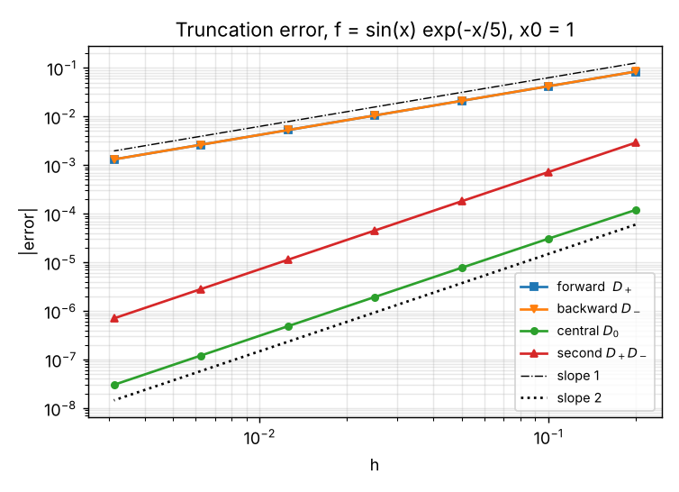

# Part 1 — Finite-Difference Approximations and the Computational Grid

> **Programs:** [`programs/finite_difference_derivatives.py`](../programs/finite_difference_derivatives.py), [`programs/generate_grid.py`](../programs/generate_grid.py)
> **Output:** [`results/02_finite_differences.txt`](../results/02_finite_differences.txt), [`results/03_grid_payoff_boundaries.txt`](../results/03_grid_payoff_boundaries.txt), [`figures/fig01_fd_truncation_error.png`](../figures/fig01_fd_truncation_error.png)

---

## 1.1 The problem

The Black–Scholes equation (Part 2) contains three derivatives of the option value $V(S,\tau)$:

$$
\frac{\partial V}{\partial \tau}, \qquad \frac{\partial V}{\partial S}, \qquad \frac{\partial^2 V}{\partial S^2}.
$$

A computer can only store $V$ at finitely many points. The finite-difference method therefore has to answer one question before anything else:

> *How can a derivative be replaced by an algebraic combination of function values at neighbouring grid points, and how large is the error made by this replacement?*

This part derives the answers from Taylor's theorem and defines the grid used throughout the project.

---

## 1.2 Notation and assumptions

| Symbol | Meaning |
|---|---|
| $f(x)$ | a function of one variable (later: $V$ as a function of $S$ or of $\tau$) |
| $h > 0$ | step size (later $h = \Delta S$ in space or $h = \Delta\tau$ in time) |
| $f', f'', f''', f^{(4)}$ | first to fourth derivatives of $f$ |
| $O(h^p)$ | a quantity bounded by $C h^p$ for small $h$, with $C$ independent of $h$ |
| $D_+,\ D_-,\ D_0,\ D_+D_-$ | forward, backward, central and second-difference operators |

**Assumption.** $f$ is smooth near $x$: for the first-order formulas $f \in C^2$, for the central first difference $f \in C^3$, for the second difference $f \in C^4$. (Part 8 discusses what happens at the strike, where this assumption fails for the payoff.)

---

## 1.3 Taylor expansions

Taylor's theorem with Lagrange remainder gives, for some $\xi_\pm$ between $x$ and $x \pm h$,

$$
f(x+h) = f(x) + h f'(x) + \frac{h^2}{2} f''(x) + \frac{h^3}{6} f'''(x) + \frac{h^4}{24} f^{(4)}(\xi_+), \qquad\qquad (1.1)
$$

$$
f(x-h) = f(x) - h f'(x) + \frac{h^2}{2} f''(x) - \frac{h^3}{6} f'''(x) + \frac{h^4}{24} f^{(4)}(\xi_-). \qquad\qquad (1.2)
$$

Every formula below is obtained by combining (1.1) and (1.2) so that the unwanted derivatives cancel.

---

## 1.4 First derivative

**Forward difference.** Truncate (1.1) after the $h^2$ term and solve for $f'(x)$:

$$
D_+ f(x) \equiv \frac{f(x+h) - f(x)}{h} = f'(x) + \frac{h}{2} f''(\xi_+). \qquad\qquad (1.3)
$$

**Backward difference.** The same with (1.2):

$$
D_- f(x) \equiv \frac{f(x) - f(x-h)}{h} = f'(x) - \frac{h}{2} f''(\xi_-). \qquad\qquad (1.4)
$$

Both errors are proportional to $h$: the one-sided formulas are **first-order accurate**, $O(h)$.

**Central difference.** Subtract (1.2) from (1.1). The even-order terms $f(x)$ and $\tfrac{h^2}{2}f''(x)$ cancel:

$$
f(x+h) - f(x-h) = 2h f'(x) + \frac{h^3}{3} f'''(x) + O(h^5).
$$

Dividing by $2h$:

$$
D_0 f(x) \equiv \frac{f(x+h) - f(x-h)}{2h} = f'(x) + \frac{h^2}{6} f'''(x) + O(h^4). \qquad\qquad (1.5)
$$

The symmetric arrangement removes the $O(h)$ term, so the central difference is **second-order accurate**, $O(h^2)$.

---

## 1.5 Second derivative

Add (1.1) and (1.2). Now the odd-order terms cancel:

$$
f(x+h) + f(x-h) = 2 f(x) + h^2 f''(x) + \frac{h^4}{12} f^{(4)}(\xi), \qquad \xi \in (x-h, x+h).
$$

Subtracting $2f(x)$ and dividing by $h^2$:

$$
D_+D_- f(x) \equiv \frac{f(x+h) - 2f(x) + f(x-h)}{h^2} = f''(x) + \frac{h^2}{12} f^{(4)}(\xi). \qquad\qquad (1.6)
$$

The name $D_+D_-$ is exact: applying the forward difference to the backward difference gives the same three-point formula. The approximation is **second-order accurate**.

---

## 1.6 Time derivative

In time only the solution at the current level is known, so the derivative is approximated by a one-sided difference over one time step $\Delta\tau$. From (1.1) with $h = \Delta\tau$:

$$
\frac{\partial V}{\partial \tau}(S,\tau) = \frac{V(S,\tau+\Delta\tau) - V(S,\tau)}{\Delta\tau} - \frac{\Delta\tau}{2} \frac{\partial^2 V}{\partial \tau^2}(S,\tau) + O(\Delta\tau^2). \qquad\qquad (1.7)
$$

If this quotient is regarded as an approximation at the *end* of the interval, $\tau+\Delta\tau$, it is still $O(\Delta\tau)$ (fully implicit method, Part 4). If it is regarded as an approximation at the *midpoint* $\tau + \Delta\tau/2$, expansion about the midpoint makes the first-order term vanish by symmetry and the error becomes $O(\Delta\tau^2)$ (Crank–Nicolson method, Part 5):

$$
\frac{V(S,\tau+\Delta\tau) - V(S,\tau)}{\Delta\tau} = \frac{\partial V}{\partial \tau}\Big(S,\tau+\tfrac{\Delta\tau}{2}\Big) + \frac{\Delta\tau^2}{24} \frac{\partial^3 V}{\partial \tau^3} + O(\Delta\tau^4). \qquad\qquad (1.8)
$$

---

## 1.7 The computational grid

The Black–Scholes problem is solved on the truncated domain $0 \le S \le S_{\max}$, $0 \le \tau \le T$ (the reason for the truncation and the choice $S_{\max}=5K$ are explained in Parts 2 and 6). Both intervals are divided uniformly:

$$
\Delta S = \frac{S_{\max}}{M}, \qquad S_j = j\,\Delta S, \qquad j = 0,1,\dots,M, \qquad\qquad (1.9)
$$

$$
\Delta\tau = \frac{T}{N}, \qquad \tau_n = n\,\Delta\tau, \qquad n = 0,1,\dots,N. \qquad\qquad (1.10)
$$

The numerical solution is the array

$$
V_j^n \approx V(S_j, \tau_n).
$$

* $j = 0$ and $j = M$ are **boundary nodes** (values prescribed by boundary conditions);
* $j = 1,\dots,M-1$ are the $M-1$ **interior unknowns**;
* $n = 0$ is the payoff (option expiry), $n = N$ is today ($\tau = T$, i.e. $t=0$).

At an interior node the stencils (1.5) and (1.6) with $h = \Delta S$ read

$$
\frac{\partial V}{\partial S}\Big|_j^n \approx \frac{V_{j+1}^n - V_{j-1}^n}{2\Delta S}, \qquad
\frac{\partial^2 V}{\partial S^2}\Big|_j^n \approx \frac{V_{j+1}^n - 2V_j^n + V_{j-1}^n}{(\Delta S)^2}, \qquad\qquad (1.11)
$$

both with error $O(\Delta S^2)$. Each uses only the three neighbours $V_{j-1}, V_j, V_{j+1}$ — the property that later makes every linear system **tridiagonal** (Part 3).

**Strike alignment.** If $K/\Delta S$ is an integer, the strike is a grid node $S_{j_K} = K$ with $j_K = K/\Delta S$. With $S_{\max} = 5K$ this holds for every $M$ divisible by 5, in particular for all $M \in \{50,100,200,400\}$ used in the refinement studies ($j_K = M/5$).

---

## 1.8 Significance

| Formula | Stencil | Error | Used for |
|---|---|---|---|
| $D_+ f$ | $f(x), f(x+h)$ | $O(h)$ | — (reference) |
| $D_- f$ | $f(x-h), f(x)$ | $O(h)$ | — (reference) |
| $D_0 f$ | $f(x\pm h)$ | $O(h^2)$ | $V_S$ in the PDE, Delta (Part 7) |
| $D_+D_- f$ | $f(x-h), f(x), f(x+h)$ | $O(h^2)$ | $V_{SS}$ in the PDE, Gamma (Part 7) |
| one-sided in $\tau$ | $V^n, V^{n+1}$ | $O(\Delta\tau)$ at $\tau_{n+1}$, $O(\Delta\tau^2)$ at $\tau_{n+1/2}$ | time stepping (Parts 4, 5) |

The order of a formula is visible numerically: halving $h$ divides an $O(h^p)$ error by $2^p$, so the **observed order**

$$
p = \frac{\log(E_h / E_{h/2})}{\log 2} \qquad\qquad (1.12)
$$

should approach 1 for one-sided and 2 for central formulas.

---

## 1.9 Implementation and verification

| Equation | Code |
|---|---|
| (1.3), (1.4), (1.5), (1.6) | `forward_diff`, `backward_diff`, `central_diff_first`, `central_diff_second` in `finite_difference_derivatives.py` |
| (1.9), (1.10) | `generate_s_grid`, `generate_tau_grid` in `generate_grid.py` |
| strike node $j_K$ | `strike_index` in `generate_grid.py` |

`finite_difference_derivatives.py` tests the formulas on $f(x) = \sin x\, e^{-x/5}$ at $x_0 = 1$, where all derivatives are known in closed form. Observed orders (from `results/02_finite_differences.txt`):

| $h$ | forward | $p$ | central | $p$ | second diff. | $p$ |
|---:|---:|---:|---:|---:|---:|---:|
| 0.2 | 8.34e-02 | – | 1.19e-04 | – | 2.88e-03 | – |
| 0.1 | 4.19e-02 | 1.00 | 3.07e-05 | 1.96 | 7.20e-04 | 2.00 |
| 0.05 | 2.10e-02 | 1.00 | 7.72e-06 | 1.99 | 1.80e-04 | 2.00 |
| 0.025 | 1.05e-02 | 1.00 | 1.93e-06 | 2.00 | 4.50e-05 | 2.00 |

The program also applies $D_0$ and $D_+D_-$ to the *analytical* Black–Scholes call at $S=K$: with exact prices as input the stencil errors for Delta and Gamma are again exactly second order (e.g. $\Delta S = 1$: $8.6\times10^{-5}$ and $2.3\times10^{-6}$). This isolates the stencil error from the PDE error that is added in Part 7.

`generate_grid.py` checks the grid end-points, uniform spacing, the position of $\tau=0$ (payoff) and $\tau=T$ (valuation), and the strike node (all reported as PASS).

