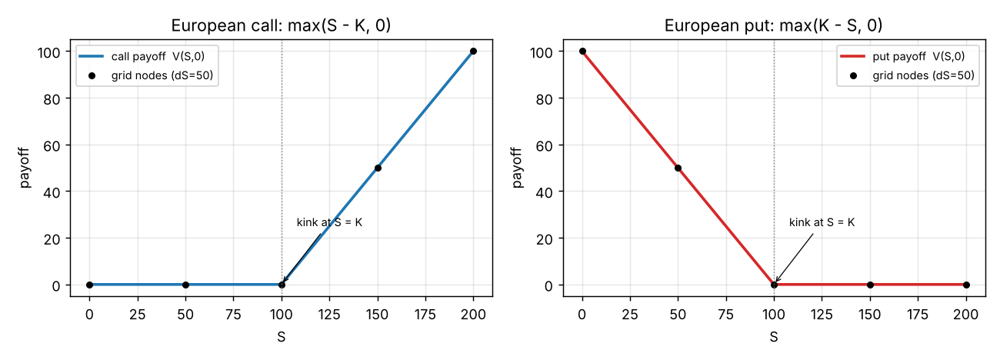

# Part 2 — The Black–Scholes Problem: Payoff, Boundary Conditions and Spatial Discretisation

> **Programs:** [`programs/black_scholes.py`](../programs/black_scholes.py), [`programs/generate_grid.py`](../programs/generate_grid.py), `operator_coefficients` in [`programs/implicit_fdm.py`](../programs/implicit_fdm.py)
> **Output:** [`results/01_black_scholes_analytic.txt`](../results/01_black_scholes_analytic.txt), [`results/03_grid_payoff_boundaries.txt`](../results/03_grid_payoff_boundaries.txt), [`figures/fig02_payoffs.png`](../figures/fig02_payoffs.png)

---

## 2.1 The problem

We want the value today of a European call or put on a non-dividend-paying asset. The value is the solution of a parabolic partial differential equation with data given at **expiry**. Before a computer can solve it, the problem must be turned into a well-posed *initial*-boundary-value problem on a *finite* domain, and the differential operator must be replaced by a discrete one. This part performs those three steps:

$$
\begin{aligned}
&\text{terminal-value PDE} \;\longrightarrow\; \text{initial-value PDE in } \tau \\
&\;\longrightarrow\; \text{finite domain + boundary data} \;\longrightarrow\; \text{discrete operator } \mathcal{L}_h .
\end{aligned}
$$

---

## 2.2 Variables, parameters and assumptions

| Symbol | Meaning | Benchmark |
|---|---|---|
| $S$ | price of the underlying asset | evaluation point $S = K = 100$ |
| $t$ | calendar time, $0 \le t \le T$ | |
| $\tau = T - t$ | time to maturity | |
| $V(S,t)$ | option value | |
| $K$ | strike | 100 |
| $T$ | maturity (years) | 1 |
| $r$ | continuously compounded risk-free rate | 0.05 |
| $\sigma$ | volatility of the asset | 0.20 |
| $S_{\max}$ | upper limit of the computational domain | $5K = 500$ |

**Assumptions (Black–Scholes model).** The asset follows geometric Brownian motion with constant $\sigma$; $r$ is constant; there are no dividends, transaction costs or arbitrage; trading is continuous; the option is European (exercise only at $T$).

---

## 2.3 The Black–Scholes equation and the time reversal

Under these assumptions the option value satisfies

$$
\frac{\partial V}{\partial t} + \frac{1}{2}\sigma^2 S^2 \frac{\partial^2 V}{\partial S^2} + r S \frac{\partial V}{\partial S} - r V = 0, \qquad 0 < S < \infty,\ 0 \le t < T. \qquad\qquad (2.1)
$$

The terms have distinct roles: $\tfrac12\sigma^2S^2V_{SS}$ is **diffusion**, $rSV_S$ is **convection** (drift), $-rV$ is **reaction** (discounting). Equation (2.1) is therefore a convection–diffusion–reaction equation with coefficients that vary with $S$.

The data are known at $t = T$, so (2.1) is a *terminal*-value problem. Introduce the time to maturity

$$
\tau = T - t \quad\Longrightarrow\quad \frac{\partial V}{\partial t} = \frac{\partial V}{\partial \tau}\frac{d\tau}{dt} = -\frac{\partial V}{\partial \tau}.
$$

Substituting into (2.1) and moving $V_\tau$ to the left gives the forward parabolic equation

$$
\boxed{\;\frac{\partial V}{\partial \tau} = \mathcal{L}V \equiv \frac{1}{2}\sigma^2 S^2 \frac{\partial^2 V}{\partial S^2} + r S \frac{\partial V}{\partial S} - r V, \qquad 0 < \tau \le T.\;} \qquad\qquad (2.2)
$$

$\tau = 0$ is expiry, $\tau = T$ is today. The numerical method marches **forward in $\tau$**, from the known payoff to the unknown present value.

---

## 2.4 Initial condition: the payoffs

At expiry the option is worth its payoff, which becomes the **initial condition** in $\tau$:

$$
\text{call: } V(S,0) = \max(S-K,0), \qquad \text{put: } V(S,0) = \max(K-S,0). \qquad\qquad (2.3)
$$

Both payoffs are continuous, but their first derivative jumps at $S=K$ (from 0 to 1 for the call, from $-1$ to 0 for the put). This **kink** is the only non-smooth feature of the problem; its numerical consequences are the subject of Part 8.

---

## 2.5 Truncated domain and boundary conditions

A computer cannot represent $0 < S < \infty$, so the domain is cut at $S_{\max}$:

$$
\Omega_h = [0, S_{\max}] \times [0, T].
$$

Boundary values are needed at both ends.

**Lower boundary $S = 0$.** Setting $S=0$ in (2.2) removes the diffusion and convection terms; the PDE degenerates to the ordinary differential equation $V_\tau = -rV$, whose solution is $V(0,\tau) = V(0,0)\,e^{-r\tau}$. With the payoffs (2.3):

$$
\text{call: } V(0,\tau) = 0, \qquad \text{put: } V(0,\tau) = K e^{-r\tau}. \qquad\qquad (2.4)
$$

These conditions are therefore *exact*, not approximations.

**Upper boundary $S = S_{\max}$.** For $S \gg K$ the call will almost surely be exercised and behaves like a forward contract, $V \approx S - Ke^{-r\tau}$; the put becomes worthless:

$$
\text{call: } V(S_{\max},\tau) = S_{\max} - K e^{-r\tau}, \qquad \text{put: } V(S_{\max},\tau) = 0. \qquad\qquad (2.5)
$$

Condition (2.5) is an approximation. Its error equals the value of the "other" option at $S_{\max}$ (by put–call parity the exact call minus $S - Ke^{-r\tau}$ is exactly the put value), which decays like $\exp\!\big(-\tfrac{(\ln(S_{\max}/K))^2}{2\sigma^2\tau}\big)$. The domain-truncation experiment (Part 6) measures its effect at $S=K$ for $S_{\max} = 2K,\dots,5K$; it is below $10^{-10}$ in every case. $S_{\max}=5K$ is used because it is conservative and puts the strike on a grid node for every $M$ in the refinement sequence.

**Compatibility.** At $\tau=0$ the boundary values (2.4)–(2.5) coincide with the payoffs: $\max(0-K,0)=0$, $S_{\max}-K = \max(S_{\max}-K,0)$, etc. The data are continuous at the corners of $\Omega_h$. The call and put data also satisfy put–call parity $C - P = S - Ke^{-r\tau}$ at both boundaries. `generate_grid.py` checks all of these properties.

---

## 2.6 Analytical benchmark

For constant coefficients (2.2)–(2.3) has the closed-form solution

$$
C(S,\tau) = S\,\Phi(d_1) - K e^{-r\tau}\Phi(d_2), \qquad P(S,\tau) = K e^{-r\tau}\Phi(-d_2) - S\,\Phi(-d_1), \qquad\qquad (2.6)
$$

$$
d_1 = \frac{\ln(S/K) + (r + \tfrac12\sigma^2)\tau}{\sigma\sqrt{\tau}}, \qquad d_2 = d_1 - \sigma\sqrt{\tau},
$$

where $\Phi$ is the standard normal distribution function. The Greeks used in Part 7 are

$$
\Delta_C = \Phi(d_1), \qquad \Delta_P = \Phi(d_1) - 1, \qquad \Gamma = \frac{\phi(d_1)}{S\sigma\sqrt{\tau}}, \qquad \phi(x) = \frac{e^{-x^2/2}}{\sqrt{2\pi}}. \qquad\qquad (2.7)
$$

At the benchmark $S=K=100$, $\tau = T = 1$: $d_1 = (0 + 0.07)/0.2 = 0.35$, $d_2 = 0.15$, and `black_scholes.py` returns

| Quantity | Value |
|---|---:|
| Call $C$ | 10.450584 |
| Put $P$ | 5.573526 |
| Call Delta | 0.636831 |
| Put Delta | −0.363169 |
| Gamma | 0.018762 |

identical to the professor's reference values, with put–call parity satisfied to round-off. The analytical routine shares only the model parameters with the solvers, so a coding error cannot be silently reproduced in both.

---

## 2.7 From the PDE to the discrete operator

On the grid of Part 1 ($S_j = j\Delta S$), replace $V_S$ and $V_{SS}$ in $\mathcal{L}$ by the central differences (1.11):

$$
\mathcal{L}_h V_j = \frac{1}{2}\sigma^2 S_j^2\,\frac{V_{j+1} - 2V_j + V_{j-1}}{(\Delta S)^2} + r S_j\,\frac{V_{j+1} - V_{j-1}}{2\Delta S} - r V_j .
$$

Collect the coefficients of $V_{j-1}$, $V_j$ and $V_{j+1}$:

$$
\mathcal{L}_h V_j = \alpha_j V_{j-1} + \beta_j V_j + \gamma_j V_{j+1}, \qquad\qquad (2.8)
$$

$$
\alpha_j = \frac{\sigma^2 S_j^2}{2(\Delta S)^2} - \frac{r S_j}{2\Delta S}, \qquad
\beta_j = -\frac{\sigma^2 S_j^2}{(\Delta S)^2} - r, \qquad
\gamma_j = \frac{\sigma^2 S_j^2}{2(\Delta S)^2} + \frac{r S_j}{2\Delta S}.
$$

Because $S_j = j\Delta S$, the mesh size cancels and the coefficients depend only on the index:

$$
\boxed{\;\alpha_j = \tfrac12\left(\sigma^2 j^2 - r j\right), \qquad \beta_j = -\left(\sigma^2 j^2 + r\right), \qquad \gamma_j = \tfrac12\left(\sigma^2 j^2 + r j\right).\;} \qquad\qquad (2.9)
$$

Two useful identities follow directly and are used later:

$$
\alpha_j + \beta_j + \gamma_j = -r, \qquad \gamma_j - \alpha_j = r j. \qquad\qquad (2.10)
$$

The first says $\mathcal{L}_h$ maps a constant to $-r$ times that constant (exact discounting of a constant); together they show $\mathcal{L}_h$ reproduces $\mathcal{L}$ exactly on linear functions $a + bS$, which is why the linear asymptote (2.5) is consistent with the discrete equations.

**Consistency.** By (1.5)–(1.6), $\mathcal{L}_h V(S_j) = \mathcal{L}V(S_j) + O(\Delta S^2)$ for smooth $V$:

$$
\mathcal{L}_h V_j - (\mathcal{L}V)(S_j) = \frac{\sigma^2 S_j^2}{24}\,(\Delta S)^2\,V_{SSSS} + \frac{r S_j}{6}\,(\Delta S)^2\,V_{SSS} + O(\Delta S^4). \qquad\qquad (2.11)
$$

**Sign of $\alpha_j$.** $\alpha_j \ge 0 \iff j \ge r/\sigma^2$. For the benchmark $r/\sigma^2 = 1.25$, so $\alpha_j > 0$ for all $j \ge 2$ and only the first interior node ($S_1 = \Delta S$, where $V$ is essentially zero for a call) has $\alpha_1 = -0.005 < 0$. This is the discrete trace of convection dominance near $S=0$ (Duffy, Ch. 15) and is harmless here; Parts 3–4 show the matrices remain strictly diagonally dominant.

---

## 2.8 The semi-discrete system and the θ-scheme

Writing (2.2) at every interior node with $\mathcal{L}$ replaced by $\mathcal{L}_h$ gives $M-1$ coupled ordinary differential equations (method of lines):

$$
\frac{dV_j}{d\tau} = \alpha_j V_{j-1} + \beta_j V_j + \gamma_j V_{j+1}, \qquad j = 1,\dots,M-1, \qquad\qquad (2.12)
$$

with $V_0(\tau)$, $V_M(\tau)$ given by (2.4)–(2.5) and $V_j(0)$ by (2.3). Integrating over one step with a weighted average of the two time levels gives the **θ-scheme**

$$
\frac{V_j^{n+1} - V_j^n}{\Delta\tau} = \theta\,\mathcal{L}_h V_j^{n+1} + (1-\theta)\,\mathcal{L}_h V_j^n, \qquad 0 \le \theta \le 1. \qquad\qquad (2.13)
$$

| $\theta$ | scheme | time accuracy | treated in |
|---|---|---|---|
| 0 | explicit Euler | $O(\Delta\tau)$, conditionally stable | — (not used) |
| 1 | fully implicit (backward Euler) | $O(\Delta\tau)$ | Part 4 |
| $\tfrac12$ | Crank–Nicolson | $O(\Delta\tau^2)$ | Part 5 |

For $\theta > 0$ the unknowns $V^{n+1}_{j-1}, V^{n+1}_j, V^{n+1}_{j+1}$ appear together in every equation, so each time step requires the solution of a tridiagonal linear system (Part 3).

---

## 2.9 Implementation

| Equation | Code |
|---|---|
| (2.3) payoff | `payoff(S, K, option)` — `generate_grid.py` |
| (2.4)–(2.5) boundary data | `boundary_values(tau, K, r, S_max, option)` — `generate_grid.py` |
| (2.6)–(2.7) analytical price and Greeks | `bs_price`, `bs_delta`, `bs_gamma` — `black_scholes.py` |
| (2.9) operator coefficients | `operator_coefficients(M, r, sigma)` — `implicit_fdm.py` (shared by all solvers) |
| benchmark and $S_{\max}$ | `parameters.py` (single source; every program accepts `--K --T --r --sigma --Smax --M --N`) |
