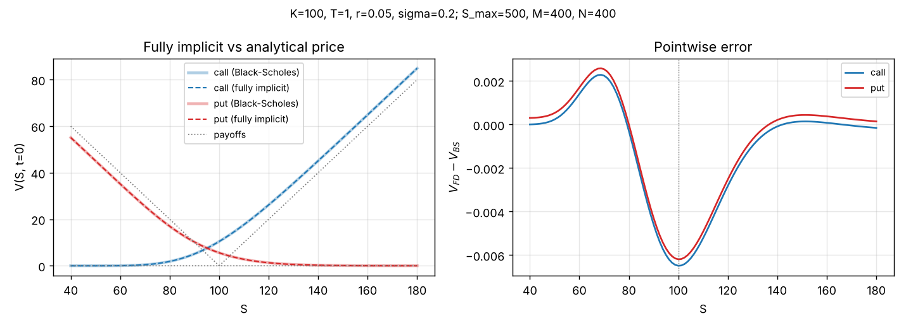

# Part 4 — The Fully Implicit (Backward Euler) Method

> **Program:** [`programs/implicit_fdm.py`](../programs/implicit_fdm.py)
> **Output:** [`results/05_fully_implicit.txt`](../results/05_fully_implicit.txt), [`figures/fig03_implicit_price_and_error.png`](../figures/fig03_implicit_price_and_error.png)

---

## 4.1 The problem

Parts 1–2 reduced the Black–Scholes problem to the system of ordinary differential equations (2.12),
$dV_j/d\tau = \mathcal{L}_h V_j$, with known boundary values and payoff. We now need a rule that advances the vector of interior values from $\tau_n$ to $\tau_{n+1} = \tau_n + \Delta\tau$ **stably for any step size**. The fully implicit method evaluates the spatial operator at the *new* time level. This part derives the resulting linear system, the boundary treatment, the algorithm, and its accuracy and stability.

---

## 4.2 Notation and assumptions

Grid and symbols as in Parts 1–2: $V_j^n \approx V(S_j,\tau_n)$, $S_j = j\Delta S$, $\tau_n = n\Delta\tau$, interior $j = 1,\dots,M-1$, and the operator coefficients

$$
\alpha_j = \tfrac12(\sigma^2 j^2 - rj), \qquad \beta_j = -(\sigma^2 j^2 + r), \qquad \gamma_j = \tfrac12(\sigma^2 j^2 + rj). \qquad\qquad (2.9)
$$

Boundary data $g_0^n = V(0,\tau_n)$ and $g_M^n = V(S_{\max},\tau_n)$ from (2.4)–(2.5); initial data $V_j^0 = \text{payoff}(S_j)$.
$r$, $\sigma$ are constant, so the coefficients do not change with $n$.

---

## 4.3 Derivation of the scheme

Set $\theta = 1$ in the θ-scheme (2.13), i.e. approximate $V_\tau$ at $\tau_{n+1}$ by the backward difference (1.7) and evaluate $\mathcal{L}_h$ at $\tau_{n+1}$:

$$
\frac{V_j^{n+1} - V_j^n}{\Delta\tau} = \alpha_j V_{j-1}^{n+1} + \beta_j V_j^{n+1} + \gamma_j V_{j+1}^{n+1}. \qquad\qquad (4.1)
$$

Multiply by $\Delta\tau$ and collect all unknowns (level $n+1$) on the left:

$$
-\Delta\tau\,\alpha_j\,V_{j-1}^{n+1} + \left(1 - \Delta\tau\,\beta_j\right)V_j^{n+1} - \Delta\tau\,\gamma_j\,V_{j+1}^{n+1} = V_j^n. \qquad\qquad (4.2)
$$

Define

$$
\begin{aligned}
a_j &= -\Delta\tau\,\alpha_j = -\frac{\Delta\tau}{2}\left(\sigma^2 j^2 - rj\right), \\
b_j &= 1 - \Delta\tau\,\beta_j = 1 + \Delta\tau\left(\sigma^2 j^2 + r\right), \\
c_j &= -\Delta\tau\,\gamma_j = -\frac{\Delta\tau}{2}\left(\sigma^2 j^2 + rj\right),
\end{aligned} \qquad\qquad (4.3)
$$

so that every interior equation reads

$$
a_j V_{j-1}^{n+1} + b_j V_j^{n+1} + c_j V_{j+1}^{n+1} = V_j^n, \qquad j = 1,\dots,M-1. \qquad\qquad (4.4)
$$

---

## 4.4 Boundary contributions

For $j = 1$ the equation contains $V_0^{n+1} = g_0^{n+1}$, and for $j = M-1$ it contains $V_M^{n+1} = g_M^{n+1}$. Both are known, so they are moved to the right-hand side:

$$
b_1 V_1^{n+1} + c_1 V_2^{n+1} = V_1^n - a_1\,g_0^{n+1}, \qquad\qquad (4.5)
$$

$$
a_{M-1} V_{M-2}^{n+1} + b_{M-1} V_{M-1}^{n+1} = V_{M-1}^n - c_{M-1}\,g_M^{n+1}. \qquad\qquad (4.6)
$$

Note the boundary values are taken at the **new** level $\tau_{n+1}$, consistently with (4.1). (For the call $g_0 = 0$, so only (4.6) is active; for the put only (4.5).)

---

## 4.5 Matrix form

With $\mathbf{V}^n = (V_1^n,\dots,V_{M-1}^n)^{\mathsf T}$:

$$
A\,\mathbf{V}^{n+1} = \mathbf{V}^n + \mathbf{g}^{n+1}, \qquad
A = \begin{pmatrix}
b_1 & c_1 & & \\
a_2 & b_2 & c_2 & \\
 & \ddots & \ddots & \ddots \\
 & & a_{M-1} & b_{M-1}
\end{pmatrix}, \qquad
\mathbf{g}^{n+1} = \begin{pmatrix} -a_1 g_0^{n+1} \\ 0 \\ \vdots \\ 0 \\ -c_{M-1} g_M^{n+1} \end{pmatrix}. \qquad\qquad (4.7)
$$

Equivalently $A = I - \Delta\tau\,L_h$, where $L_h$ is the tridiagonal matrix with rows $(\alpha_j, \beta_j, \gamma_j)$. Because the parameters are constant, $A$ is the same at every step; only the right-hand side changes.

---

## 4.6 Algorithm

```
1  build S_j = j dS (j = 0..M), dtau = T/N, V^0_j = payoff(S_j)
2  build alpha_j, beta_j, gamma_j and a_j, b_j, c_j  (j = 1..M-1)          (2.9), (4.3)
3  for n = 0 .. N-1:
4      tau = (n+1) dtau;  g0, gM = boundary_values(tau)                      (2.4)-(2.5)
5      d_j = V^n_j  (j = 1..M-1)
6      d_1 -= a_1 g0;   d_{M-1} -= c_{M-1} gM                                 (4.5)-(4.6)
7      solve A V^{n+1}_int = d with the Thomas algorithm                     (3.6)-(3.7)
8      V^{n+1}_0 = g0,  V^{n+1}_M = gM
9  return V^N   (option values at tau = T, i.e. today)
```

---

## 4.7 Accuracy: local truncation error

Insert the exact solution $V(S_j,\tau_n)$ into (4.1). By (1.7) expanded about $\tau_{n+1}$ and (2.11):

$$
\frac{V(S_j,\tau_{n+1}) - V(S_j,\tau_n)}{\Delta\tau} - \mathcal{L}_h V(S_j,\tau_{n+1})
= \underbrace{\frac{\Delta\tau}{2}\,V_{\tau\tau}}_{\text{time}} \;-\; \underbrace{\left(\frac{\sigma^2 S_j^2}{24} V_{SSSS} + \frac{rS_j}{6} V_{SSS}\right)(\Delta S)^2}_{\text{space}} + \dots
$$

Hence the scheme is **consistent** with local truncation error

$$
\mathcal{T}_{\text{Imp}} = O(\Delta\tau) + O(\Delta S^2), \qquad\qquad (4.8)
$$

first order in time and second order in space, provided $V$ is smooth (Part 8 discusses the strike at $\tau \to 0$).

---

## 4.8 Stability

**Amplification of a mode.** $L_h$ has real negative eigenvalues $\mu_k$ (for $j \ge 2$, $\alpha_j\gamma_j > 0$ makes $L_h$ similar to a symmetric matrix; Gershgorin's theorem with (2.10) places every eigenvalue in $[\,-2\sigma^2 j^2 - r,\ -r\,]$ for the rows with $\alpha_j \ge 0$, and in $[-\sigma^2 - 2r, -\sigma^2]$ for row 1). Expanding the error in eigenvectors, each component is multiplied per step by

$$
G_{\text{BE}}(z) = \frac{1}{1 - z}, \qquad z = \Delta\tau\,\mu_k \le 0 \quad\Longrightarrow\quad 0 < G_{\text{BE}} < 1. \qquad\qquad (4.9)
$$

The scheme is therefore **unconditionally stable** — no restriction such as $\Delta\tau \le C\Delta S^2$ is needed. Moreover $G_{\text{BE}}(z) \to 0$ as $z \to -\infty$ (**L-stability**): the stiffest, most oscillatory modes are damped most strongly. This property is what makes the method robust at the payoff kink (Part 8).

**Discrete maximum principle.** $A = I - \Delta\tau L_h$ has positive diagonal, non-positive off-diagonals wherever $\alpha_j \ge 0$, and is strictly diagonally dominant (Part 3). Such a matrix is an M-matrix, so $A^{-1} \ge 0$ entrywise: non-negative data produce a non-negative solution. At the benchmark the off-diagonal sign condition fails only in row 1 ($\alpha_1 = -0.005$), where the call value is zero; the computed call is non-negative and non-decreasing in $S$ on the whole grid (checked by the program).

**Convergence.** Consistency (4.8) plus stability give convergence (Lax equivalence, Duffy Ch. 14):

$$
\max_j \lvert V_j^N - V(S_j,T)\rvert = O(\Delta\tau) + O(\Delta S^2). \qquad\qquad (4.10)
$$

Stability does **not** mean accuracy: a large $\Delta\tau$ gives a stable but first-order-inaccurate answer.

---

## 4.9 Implementation

| Equation | Code (`implicit_fdm.py`) |
|---|---|
| (2.9) | `operator_coefficients(M, r, sigma)` |
| (4.3), (4.5)–(4.6) | `implicit_step(V_int, alpha, beta, gamma, dt, V0_new, VM_new)` |
| algorithm 4.6 | `implicit_solver(K, T, r, sigma, S_max, M, N, option)` |
| error norms | `error_norms(S, V, ...)` — $\lVert e\rVert_\infty$ and $\lVert e\rVert_2 = (\Delta S\sum e_j^2)^{1/2}$ |

`implicit_step` is reused by the improved Crank–Nicolson start-up (Part 8) with step $\Delta\tau/2$.

---

## 4.10 Numerical results (benchmark, $S_{\max} = 500$, $M = N = 400$)

| | $V_{FD}(K)$ | $V_{BS}(K)$ | error | $\lVert e\rVert_\infty$ | $\lVert e\rVert_2$ |
|---|---:|---:|---:|---:|---:|
| Call | 10.444095 | 10.450584 | −6.49e-03 | 6.49e-03 | 3.30e-02 |
| Put  | 5.567335 | 5.573526 | −6.19e-03 | 6.19e-03 | 3.14e-02 |

Qualitative checks (Plan §6.16): $\min_j V_j = 0$, $\min_j (V_{j+1}-V_j) \ge 0$ for the call, and Thomas vs NumPy on the first step agree to $3\times10^{-13}$. The residual $3\times10^{-4}$ in put–call parity is not an error in the code: the backward-Euler recursion discounts the boundary value by $(1+r\Delta\tau)^{-N}$ instead of $e^{-rT}$, and $100\,[(1+0.05/400)^{-400} - e^{-0.05}] = 2.97\times10^{-4}$ exactly — a visible instance of the $O(\Delta\tau)$ temporal error.

Under independent refinement (Part 6) the method shows observed order **2.0 in space** and **1.0 in time**, as predicted by (4.10).


