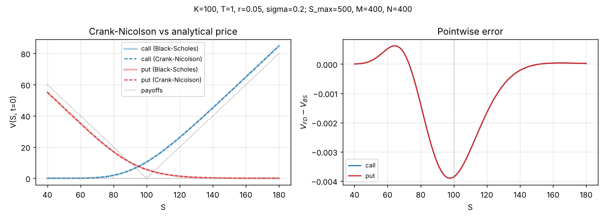

# Part 5 — The Crank–Nicolson Method

> **Program:** [`programs/crank_nicolson.py`](../programs/crank_nicolson.py)
> **Output:** [`results/06_crank_nicolson.txt`](../results/06_crank_nicolson.txt), [`figures/fig04_crank_nicolson_price_and_error.png`](../figures/fig04_crank_nicolson_price_and_error.png)

---

## 5.1 The problem

The fully implicit method (Part 4) is robust but only first-order accurate in time: halving $\Delta\tau$ only halves the temporal error. Since the spatial error is already $O(\Delta S^2)$, we look for a time discretisation that is also **second order** while keeping the tridiagonal structure and unconditional stability. Crank–Nicolson achieves this by centring the scheme at the midpoint $\tau_{n+1/2} = \tau_n + \Delta\tau/2$.

---

## 5.2 Notation and assumptions

As in Part 4: $V_j^n$, coefficients $\alpha_j, \beta_j, \gamma_j$ from (2.9), boundary data $g_0^n, g_M^n$, constant $r$ and $\sigma$. Smoothness of $V$ in $\tau$ up to third derivatives is assumed for the accuracy statement (it fails at $\tau = 0$ near $S = K$; see Part 8).

---

## 5.3 Derivation of the scheme

**Idea.** By (1.8) the difference quotient $(V^{n+1} - V^n)/\Delta\tau$ approximates $V_\tau$ at the midpoint with error $O(\Delta\tau^2)$. The spatial operator must then also be evaluated at the midpoint. The trapezoidal average

$$
\mathcal{L}_h V\big(\tau_{n+1/2}\big) = \tfrac12\left(\mathcal{L}_h V^{n+1} + \mathcal{L}_h V^n\right) + O(\Delta\tau^2)
$$

does this without introducing an unknown half level. This is the θ-scheme (2.13) with $\theta = \tfrac12$:

$$
\frac{V_j^{n+1} - V_j^n}{\Delta\tau} = \frac12\left(\mathcal{L}_h V_j^{n+1} + \mathcal{L}_h V_j^n\right). \qquad\qquad (5.1)
$$

**Expansion.** Insert (2.8):

$$
V_j^{n+1} - V_j^n = \frac{\Delta\tau}{2}\Big[\alpha_j\left(V_{j-1}^{n+1} + V_{j-1}^n\right) + \beta_j\left(V_j^{n+1} + V_j^n\right) + \gamma_j\left(V_{j+1}^{n+1} + V_{j+1}^n\right)\Big]. \qquad\qquad (5.2)
$$

**Separation of levels.** Unknowns $(n+1)$ to the left, known values $(n)$ to the right:

$$
\begin{aligned}
&-\frac{\Delta\tau}{2}\alpha_j V_{j-1}^{n+1} + \left(1 - \frac{\Delta\tau}{2}\beta_j\right)V_j^{n+1} - \frac{\Delta\tau}{2}\gamma_j V_{j+1}^{n+1} \\
&\qquad = \frac{\Delta\tau}{2}\alpha_j V_{j-1}^{n} + \left(1 + \frac{\Delta\tau}{2}\beta_j\right)V_j^{n} + \frac{\Delta\tau}{2}\gamma_j V_{j+1}^{n}.
\end{aligned} \qquad\qquad (5.3)
$$

Define the coefficients of the two tridiagonal matrices

$$
\begin{aligned}
&a_j^{A} = -\tfrac{\Delta\tau}{2}\alpha_j,\quad b_j^{A} = 1 - \tfrac{\Delta\tau}{2}\beta_j,\quad c_j^{A} = -\tfrac{\Delta\tau}{2}\gamma_j; \\
&a_j^{B} = \tfrac{\Delta\tau}{2}\alpha_j,\quad b_j^{B} = 1 + \tfrac{\Delta\tau}{2}\beta_j,\quad c_j^{B} = \tfrac{\Delta\tau}{2}\gamma_j.
\end{aligned} \qquad\qquad (5.4)
$$

Note $A = I - \tfrac{\Delta\tau}{2}L_h$ and $B = I + \tfrac{\Delta\tau}{2}L_h$.

---

## 5.4 Boundary contributions

Equation (5.3) for $j=1$ contains $V_0$ at **both** levels, and for $j = M-1$ it contains $V_M$ at both levels. With $\mathbf{d} = B\,\mathbf{V}^n$ computed from the interior values, the known boundary terms are added as

$$
d_1 \;\mathrel{+}=\; a_1^{B}\,g_0^{n} - a_1^{A}\,g_0^{n+1} \;=\; \tfrac{\Delta\tau}{2}\alpha_1\left(g_0^n + g_0^{n+1}\right), \qquad\qquad (5.5)
$$

$$
d_{M-1} \;\mathrel{+}=\; c_{M-1}^{B}\,g_M^{n} - c_{M-1}^{A}\,g_M^{n+1} \;=\; \tfrac{\Delta\tau}{2}\gamma_{M-1}\left(g_M^n + g_M^{n+1}\right). \qquad\qquad (5.6)
$$

The signs follow directly from (5.3): the right-hand boundary term $+\tfrac{\Delta\tau}{2}\alpha_1 g_0^n$ stays, and the left-hand term $-\tfrac{\Delta\tau}{2}\alpha_1 g_0^{n+1}$ changes sign when moved to the right. The boundary data enter as the **average of the two levels**, exactly as the interior values do.

---

## 5.5 Matrix form and algorithm

$$
A\,\mathbf{V}^{n+1} = B\,\mathbf{V}^{n} + \mathbf{g}^{n,n+1}, \qquad
\mathbf{g}^{n,n+1} = \tfrac{\Delta\tau}{2}\left(\alpha_1(g_0^n + g_0^{n+1}),\,0,\,\dots,\,0,\,\gamma_{M-1}(g_M^n + g_M^{n+1})\right)^{\mathsf T}. \qquad\qquad (5.7)
$$

```
1  V^0_j = payoff(S_j);  build alpha, beta, gamma and the coefficients (5.4)
2  for n = 0 .. N-1:
3      (g0_old, gM_old) = boundary_values(tau_n);  (g0_new, gM_new) = boundary_values(tau_{n+1})
4      d_j = a^B_j V^n_{j-1} + b^B_j V^n_j + c^B_j V^n_{j+1}       (interior products B V^n)
5      d_1 += a^B_1 g0_old - a^A_1 g0_new;   d_{M-1} += c^B_{M-1} gM_old - c^A_{M-1} gM_new
6      solve A V^{n+1}_int = d  (Thomas);  set V^{n+1}_0 = g0_new, V^{n+1}_M = gM_new
```

Each step costs one tridiagonal multiply and one Thomas solve, i.e. the same $O(M)$ work as the fully implicit method.

---

## 5.6 Accuracy

Insert the exact solution into (5.1) and expand about $\tau_{n+1/2}$. By (1.8), the time quotient equals $V_\tau(\tau_{n+1/2}) + \tfrac{\Delta\tau^2}{24}V_{\tau\tau\tau}$; the trapezoidal average equals $\mathcal{L}_h V(\tau_{n+1/2}) + \tfrac{\Delta\tau^2}{8}\mathcal{L}_h V_{\tau\tau}$. The $O(\Delta\tau)$ terms cancel by symmetry and

$$
\mathcal{T}_{\text{CN}} = O(\Delta\tau^2) + O(\Delta S^2). \qquad\qquad (5.8)
$$

Both spatial and temporal errors are now second order, so refining $\Delta S$ and $\Delta\tau$ together by a factor 2 should reduce the error by a factor 4 (observed in Part 6).

---

## 5.7 Stability — and its limitation

For an eigenmode of $L_h$ with eigenvalue $\mu \le 0$ and $z = \Delta\tau\,\mu$, (5.1) multiplies the mode by

$$
G_{\text{CN}}(z) = \frac{1 + z/2}{1 - z/2}, \qquad \lvert G_{\text{CN}}(z)\rvert \le 1 \ \text{ for all } z \le 0. \qquad\qquad (5.9)
$$

Crank–Nicolson is therefore **unconditionally stable** (A-stable). It is the (1,1) Padé approximation of $e^{z}$, which explains its second-order accuracy.

However,

$$
\lim_{z\to-\infty} G_{\text{CN}}(z) = -1, \qquad\qquad (5.10)
$$

so CN is **not L-stable**: very stiff modes (large $\lvert\mu\rvert\Delta\tau$) are hardly damped and change sign at every step. Smooth data contain almost no such modes and CN is excellent. The kinked payoff, however, excites them at $S = K$, which can produce persistent oscillations that are invisible in the price but obvious in Gamma. This limitation is analysed and cured in Part 8:

$$
\text{stable} \;\not\Rightarrow\; \text{non-oscillatory}.
$$

Unlike the fully implicit matrix, the right-hand matrix $B = I + \tfrac{\Delta\tau}{2}L_h$ has diagonal $1 - \tfrac{\Delta\tau}{2}(\sigma^2 j^2 + r)$, which becomes negative when $\Delta\tau\,\sigma^2 j^2 > 2$; the discrete maximum principle (and with it guaranteed positivity) is then lost. This is the matrix form of the same phenomenon.

---

## 5.8 Improved Crank–Nicolson (implemented in the same program)

`crank_nicolson_solver(..., startup=s)` replaces each of the first $s$ CN steps by **two backward-Euler half-steps** of length $\Delta\tau/2$ (Rannacher start-up), reusing `implicit_step` from Part 4. $s = 0$ is pure CN; $s = 1$ is the improved CN used in Parts 7–8. The derivation and the justification are given in Part 8.

---

## 5.9 Implementation

| Equation | Code (`crank_nicolson.py`) |
|---|---|
| (5.4)–(5.6) | `cn_step(V_int, alpha, beta, gamma, dt, bc_old, bc_new)` |
| algorithm 5.5 | `crank_nicolson_solver(K, T, r, sigma, S_max, M, N, option, startup=0)` |
| start-up (Part 8) | `crank_nicolson_solver(..., startup=1)` = `improved_crank_nicolson_solver` |

The program verifies the first step against `numpy.linalg.solve` with the explicit matrices $A$ and $B$ (difference $2.8\times10^{-13}$). The original CN implementation of the project was checked against this version and agrees to $10^{-12}$; it was correct and has been preserved in substance, only reorganised to share the grid, payoff, boundary and Thomas routines.

---

## 5.10 Numerical results (benchmark, $S_{\max} = 500$, $M = N = 400$)

| | $V_{FD}(K)$ | $V_{BS}(K)$ | error | $\lVert e\rVert_\infty$ | $\lVert e\rVert_2$ |
|---|---:|---:|---:|---:|---:|
| Call | 10.446723 | 10.450584 | −3.86e-03 | 3.90e-03 | 2.01e-02 |
| Put  | 5.569665 | 5.573526 | −3.86e-03 | 3.90e-03 | 2.01e-02 |

Call and put errors are identical, and put–call parity holds to $6\times10^{-9}$: the CN recursion discounts with $\big(\tfrac{1 - r\Delta\tau/2}{1 + r\Delta\tau/2}\big)^N$, which agrees with $e^{-rT}$ to $O(\Delta\tau^2)$. On this grid the remaining error is almost entirely spatial ($\Delta S = 1.25$): the temporal part, measured in Part 6, is only $1.6\times10^{-6}$.


