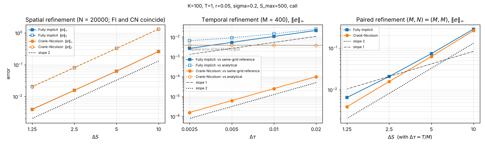
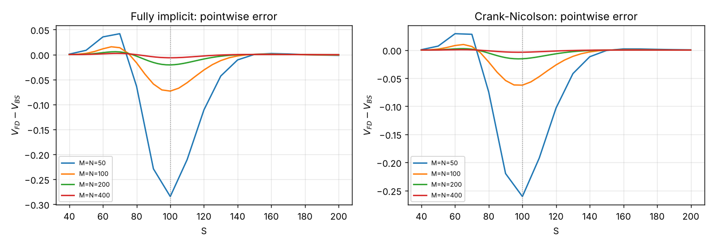

# Part 6 — Consistency, Stability, Convergence and Domain Truncation

> **Program:** [`programs/convergence_study.py`](../programs/convergence_study.py)
> **Output:** [`results/07_convergence_study.txt`](../results/07_convergence_study.txt), [`figures/fig05_convergence.png`](../figures/fig05_convergence.png), [`figures/fig06_pointwise_error_refinement.png`](../figures/fig06_pointwise_error_refinement.png)

---

## 6.1 The problem

Parts 4 and 5 *predict* the accuracy of the two schemes:

| Method | temporal order | spatial order |
|---|:---:|:---:|
| Fully implicit | 1 | 2 |
| Crank–Nicolson | 2 | 2 |

A prediction is not evidence. This part (i) states the theory that links the local truncation error to the actual error, (ii) designs experiments that measure the spatial and temporal orders **independently**, (iii) quantifies the error caused by cutting the domain at $S_{\max}$, and (iv) reports the measured results for the professor's benchmark.

---

## 6.2 Error sources and assumptions

The computed value at a node differs from the Black–Scholes value for three distinct reasons:

$$
V_j^N - V(S_j,T) \;=\; \underbrace{e_{\Delta S}}_{\text{space}} \;+\; \underbrace{e_{\Delta\tau}}_{\text{time}} \;+\; \underbrace{e_{S_{\max}}}_{\text{domain truncation}} \;(+\ \text{round-off}). \tag{6.1}
$$

For a smooth solution the theory of Parts 4–5 gives

$$
e \approx C_S\,\Delta S^{2} + C_\tau\,\Delta\tau^{q} + e_{S_{\max}}, \qquad q = 1 \text{ (implicit)},\ q = 2 \text{ (CN)}. \tag{6.2}
$$

A refinement experiment measures one term only if the other two are kept negligible. All experiments use the benchmark $K=100$, $T=1$, $r=0.05$, $\sigma=0.20$, the call option, and $S_{\max} = 5K$ (justified in §6.8). With $S_{\max}=5K$ the strike is a node for every $M$ used ($j_K = M/5$), so the kink is sampled identically on every grid.

---

## 6.3 Consistency, stability and convergence

* **Consistency:** the local truncation error tends to zero as $\Delta S, \Delta\tau \to 0$ — shown in (4.8) and (5.8).
* **Stability:** errors introduced at one step are not amplified — shown by the amplification factors (4.9) and (5.9), $\lvert G\rvert \le 1$ for every step size.
* **Convergence:** by the Lax equivalence theorem (Duffy, Theorem 14.1), a consistent scheme for a well-posed linear problem converges if and only if it is stable, and the global error inherits the order of the truncation error:

$$
\text{consistency} + \text{stability} \;\Longrightarrow\; \text{convergence}, \qquad
\lVert V^N - V(\cdot,T)\rVert = O(\Delta\tau^{q}) + O(\Delta S^2). \tag{6.3}
$$

---

## 6.4 Error norms and observed order

With $e_j = V_j^N - V(S_j,T)$ on the interior nodes,

$$
\lVert e\rVert_\infty = \max_{1\le j\le M-1}\lvert e_j\rvert, \qquad
\lVert e\rVert_2 = \Big(\Delta S\sum_{j=1}^{M-1} e_j^2\Big)^{1/2}. \tag{6.4}
$$

The factor $\Delta S$ makes $\lVert e\rVert_2$ a discrete approximation of the continuous $L_2$ norm, so values from different grids are comparable.

**Observed order.** If $E_h \approx C h^p$, then $E_{h/2} \approx C h^p 2^{-p}$, hence $E_h/E_{h/2} = 2^p$ and

$$
p = \frac{\log\left(E_h/E_{h/2}\right)}{\log 2}. \tag{6.5}
$$

On a log–log plot $\log E_h = \log C + p\log h$, so $p$ is the slope of the error curve.

---

## 6.5 Experimental design

**Spatial refinement.** $M = 50, 100, 200, 400$ ($\Delta S = 10, 5, 2.5, 1.25$) with $N = 20000$ fixed. The temporal error is then about $5\times10^{-5}$ for the implicit method and $\sim10^{-9}$ for CN, small compared with the smallest spatial error ($\approx 4\times10^{-3}$). Error measured against the analytical solution.

**Temporal refinement.** $N = 50, 100, 200, 400$ with $M = 400$ fixed. Here measuring against the analytical solution does **not** work for CN: the spatial error of the $M=400$ grid ($3.9\times10^{-3}$) is three orders of magnitude larger than the CN temporal error, so the total error would stay at the spatial floor and the "observed order" would be $\approx 0$. Since the spatial grid is the same for all $N$, the spatial error is the same too; it is removed by comparing with a reference solution computed **on the same spatial grid** with a very small step, $N_{\text{ref}} = 12800$:

$$
e_{\Delta\tau} = V^{N}_{M} - V^{N_{\text{ref}}}_{M}. \tag{6.6}
$$

Both solutions share $e_{\Delta S}$ and $e_{S_{\max}}$, which cancel; what remains is the temporal error of the semi-discrete system (2.12). The reference uses CN with implicit start-up, whose own temporal error at $N_{\text{ref}}$ is $\sim10^{-9}$. The error against the analytical solution is reported alongside, to show the spatial floor explicitly.

**Paired refinement.** $(M,N) = (50,50),\dots,(400,400)$, i.e. $\Delta S$ and $\Delta\tau$ halved together, error against the analytical solution. With $\Delta\tau = T\,\Delta S/S_{\max}$, (6.2) gives

$$
E \approx C_S\Delta S^2 + C_\tau' \Delta S^{q}, \tag{6.7}
$$

so CN should show $p = 2$, while the implicit method moves from $p\approx2$ (coarse grids, spatial error dominant) towards $p = 1$ (fine grids, temporal error dominant). Paired refinement is therefore *not* a substitute for the independent studies: it can only show the slowest of the two orders.

---

## 6.6 Results

**Spatial refinement** ($N = 20000$; from `results/07_convergence_study.txt`):

| $M$ | $\Delta S$ | Implicit $\lVert e\rVert_\infty$ | $p_\infty$ | Implicit $\lVert e\rVert_2$ | $p_2$ | CN $\lVert e\rVert_\infty$ | $p_\infty$ | CN $\lVert e\rVert_2$ | $p_2$ |
|---:|---:|---:|---:|---:|---:|---:|---:|---:|---:|
| 50 | 10 | 2.608e-01 | – | 1.316e+00 | – | 2.608e-01 | – | 1.316e+00 | – |
| 100 | 5 | 6.254e-02 | 2.06 | 3.239e-01 | 2.02 | 6.248e-02 | 2.06 | 3.236e-01 | 2.02 |
| 200 | 2.5 | 1.571e-02 | 1.99 | 8.083e-02 | 2.00 | 1.566e-02 | 2.00 | 8.061e-02 | 2.01 |
| 400 | 1.25 | 3.955e-03 | 1.99 | 2.036e-02 | 1.99 | 3.906e-03 | 2.00 | 2.013e-02 | 2.00 |

Both methods are second order in space, and their spatial errors coincide because they use the same operator $\mathcal{L}_h$.

**Temporal refinement** ($M = 400$, error against the same-grid reference $N_{\text{ref}} = 12800$):

| $N$ | $\Delta\tau$ | Implicit $\lVert e_{\Delta\tau}\rVert_\infty$ | $p$ | CN $\lVert e_{\Delta\tau}\rVert_\infty$ | $p$ | CN error vs analytical |
|---:|---:|---:|---:|---:|---:|---:|
| 50 | 0.02 | 2.144e-02 | – | 1.008e-04 | – | 3.815e-03 |
| 100 | 0.01 | 1.073e-02 | 1.00 | 2.520e-05 | 2.00 | 3.883e-03 |
| 200 | 0.005 | 5.365e-03 | 1.00 | 6.301e-06 | 2.00 | 3.900e-03 |
| 400 | 0.0025 | 2.683e-03 | 1.00 | 1.577e-06 | 2.00 | 3.904e-03 |

The $L_2$ norm and the error at $S=K$ give the same orders (1.00 and 2.00). The last column is the CN error against the analytical solution: it stays at the spatial error of the grid, $3.906\times10^{-3}$, exactly as explained in §6.5.

**Paired refinement** (error against the analytical solution):

| $(M,N)$ | Implicit $\lvert e(K)\rvert$ | Implicit $\lVert e\rVert_\infty$ | $p$ | CN $\lvert e(K)\rvert$ | CN $\lVert e\rVert_\infty$ | $p$ |
|---|---:|---:|---:|---:|---:|---:|
| (50,50) | 2.844e-01 | 2.844e-01 | – | 2.607e-01 | 2.607e-01 | – |
| (100,100) | 7.322e-02 | 7.322e-02 | 1.96 | 6.246e-02 | 6.246e-02 | 2.06 |
| (200,200) | 2.076e-02 | 2.076e-02 | 1.82 | 1.548e-02 | 1.565e-02 | 2.00 |
| (400,400) | 6.488e-03 | 6.488e-03 | 1.68 | 3.861e-03 | 3.904e-03 | 2.00 |

CN keeps $p = 2$; the implicit method drifts from 2 towards 1 as predicted by (6.7).

---

## 6.7 Effect of the non-smooth payoff on the observed orders

The truncation-error estimates assume smooth $V$, but $V(S,0)$ has a kink at $K$ and $V_{SS}(S,0)$ is a Dirac delta. Two observations explain why the clean orders above are nevertheless obtained:

1. For $\tau > 0$ the Black–Scholes operator smooths the solution instantly (Gamma at $\tau = T$ is a smooth bell curve). The kink therefore affects only the first few steps.
2. The strike is a grid node on every grid, so the payoff is represented without an $O(\Delta S)$ sampling error, and on these grids ($\lambda_K = \sigma^2K^2\Delta\tau/\Delta S^2 \le 5.1$) the CN amplification of the stiffest mode near the strike, $(1-\lambda_K)/(1+\lambda_K)$, is at most $0.67$ in magnitude, so the kink modes are damped long before $\tau = T$.

The pointwise error profiles (figure below) show that the error is concentrated around the strike, as expected. Part 8 shows what happens when condition 2 is violated ($\lambda_K \gg 1$): pure CN then loses accuracy near $K$, most visibly in Gamma.

---

## 6.8 Domain truncation

**Why it is needed.** The problem is posed on $0 < S < \infty$ but solved on $[0, S_{\max}]$ with the asymptotic condition (2.5). Refining $\Delta S$ cannot remove the error of a boundary that is too close: it is a separate error source (6.1).

**Size of the error.** The exact call satisfies $C(S,\tau) - (S - Ke^{-r\tau}) = P(S,\tau)$, so the boundary condition is wrong by the put value at $S_{\max}$, which decays faster than any power of $S_{\max}/K$. This boundary error is then further attenuated as it diffuses from $S_{\max}$ back to $S = K$.

**Experiment (Plan §7.15).** $S_{\max} = 2K, 3K, 4K, 5K$ with the *same* $\Delta S = 1.25$ (so the discretisation error is identical and only the domain changes), CN, $N = 400$:

| $S_{\max}$ | $M$ | $C(K)$ | $C(K) - C_{BS}$ | $P(K)$ | $P(K) - P_{BS}$ | $\lvert C - C_{5K}\rvert$ |
|---:|---:|---:|---:|---:|---:|---:|
| $2K$ | 160 | 10.446722938 | −3.861e-03 | 5.569665382 | −3.861e-03 | 6.8e-12 |
| $3K$ | 240 | 10.446722938 | −3.861e-03 | 5.569665382 | −3.861e-03 | 0 |
| $4K$ | 320 | 10.446722938 | −3.861e-03 | 5.569665382 | −3.861e-03 | 0 |
| $5K$ | 400 | 10.446722938 | −3.861e-03 | 5.569665382 | −3.861e-03 | 0 |

The price at the evaluation point changes by less than $10^{-11}$ between $2K$ and $5K$, nine orders of magnitude below the discretisation error. Domain truncation is negligible for the benchmark from $S_{\max} = 2K$ onwards.

**Choice $S_{\max} = 5K$.** Among the tested domains, $5K$ is chosen because

1. it is the most conservative (about $8\sigma\sqrt T$ above the strike in $\ln S$), so the truncation error stays negligible if $\sigma$ or $T$ are increased when the programs are re-run with other parameters; and
2. it places $K$ on a grid node for **every** $M \in \{50,100,200,400\}$ ($K/\Delta S = M/5$). With $4K$, $M = 50$ gives $\Delta S = 8$ and the strike falls midway between nodes; Part 7 shows that the error constant then changes, which would contaminate the observed order of the first refinement step.

The price paid is a coarser $\Delta S$ for a given $M$ than with $2K$; since the experiments concern *orders*, not the smallest possible error, this is the right trade-off. $S_{\max}$ is set in one place (`programs/parameters.py`) and can be overridden with `--Smax`.

---

## 6.9 Final verification table ($M = N = 400$, call)

| Method | $\lVert e\rVert_\infty$ | $\lVert e\rVert_2$ | order in space | order in time | order (paired) | spurious Gamma extrema |
|---|---:|---:|---:|---:|---:|---:|
| Fully implicit | 6.488e-03 | 3.296e-02 | 1.99 | 1.00 | 1.68 | 0 |
| Crank–Nicolson | 3.904e-03 | 2.013e-02 | 2.00 | 2.00 | 2.00 | 0 |

Orders are from the finest pair of each study; "spurious Gamma extrema" counts local extrema of the numerical Gamma in $[0.8K, 1.2K]$ beyond those of the analytical Gamma (Part 7). Both methods converge to the analytical Black–Scholes solution at exactly the theoretical rates; on this grid neither oscillates. For equal work, Crank–Nicolson is more accurate because its temporal error is negligible.
