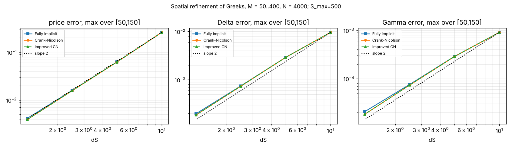
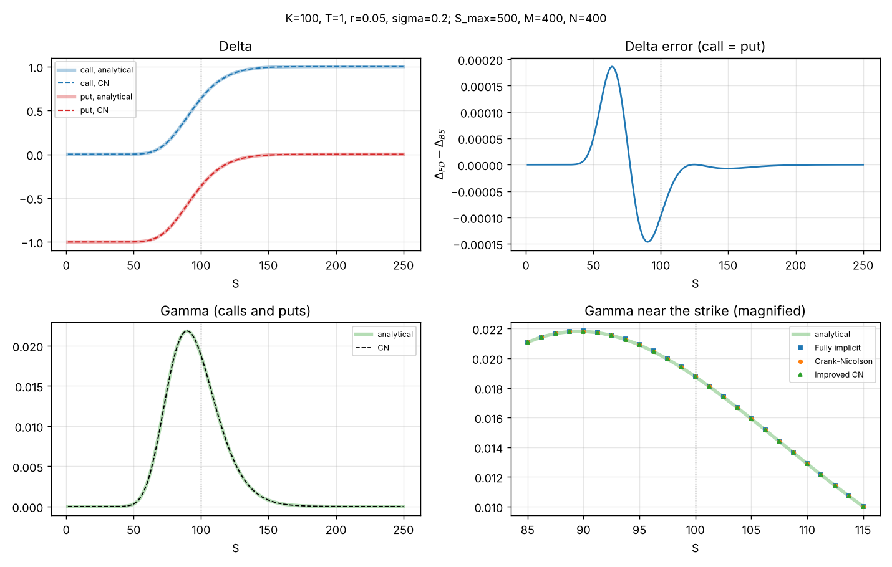

# Part 7 — Numerical Greeks: Delta and Gamma

> **Program:** [`programs/numerical_greeks.py`](../programs/numerical_greeks.py)
> **Output:** [`results/08_numerical_greeks.txt`](../results/08_numerical_greeks.txt), [`figures/fig07_numerical_greeks.png`](../figures/fig07_numerical_greeks.png), [`figures/fig08_greek_convergence.png`](../figures/fig08_greek_convergence.png)

---

## 7.1 The problem

A price alone is not enough to manage an option: the hedge ratio **Delta** and its rate of change **Gamma**,

$$
\Delta = \frac{\partial V}{\partial S}, \qquad \Gamma = \frac{\partial^2 V}{\partial S^2},
$$

are needed as well. When no closed form exists they must be extracted from the finite-difference price $V_j \approx V(S_j, T)$ itself. This part derives the divided-difference Greeks, analyses why they are *more sensitive* to numerical error than the price, and verifies them against the analytical Black–Scholes Greeks under mesh refinement and strike alignment.

---

## 7.2 Analytical Greeks (reference values)

Let $\tau$ be the time to maturity and $d_{1,2}$ as in (2.6). Two facts are needed:

$$
\frac{\partial d_1}{\partial S} = \frac{\partial d_2}{\partial S} = \frac{1}{S\sigma\sqrt\tau}, \qquad S\,\phi(d_1) = K e^{-r\tau}\phi(d_2). \qquad\qquad (7.1)
$$

The second identity follows from $d_1^2 - d_2^2 = (d_1 - d_2)(d_1 + d_2) = \sigma\sqrt\tau\,(d_1+d_2) = 2\ln(S/K) + 2r\tau$, so $\phi(d_2)/\phi(d_1) = e^{(d_1^2-d_2^2)/2} = (S/K)e^{r\tau}$.

Differentiating $C = S\Phi(d_1) - Ke^{-r\tau}\Phi(d_2)$:

$$
\frac{\partial C}{\partial S} = \Phi(d_1) + \underbrace{\big(S\phi(d_1) - Ke^{-r\tau}\phi(d_2)\big)}_{=0 \text{ by } (7.1)}\frac{1}{S\sigma\sqrt\tau} = \Phi(d_1),
$$

$$
\Delta_C = \Phi(d_1), \qquad \Delta_P = \Phi(d_1) - 1, \qquad \Gamma = \frac{\partial \Phi(d_1)}{\partial S} = \frac{\phi(d_1)}{S\sigma\sqrt\tau}. \qquad\qquad (7.2)
$$

$\Delta_P$ follows from put–call parity $C - P = S - Ke^{-r\tau}$; differentiating parity twice shows that **Gamma is the same for calls and puts**. Benchmark ($S = K = 100$, $\tau = 1$): $\Delta_C = 0.636831$, $\Delta_P = -0.363169$, $\Gamma = 0.018762$.

The analytical Gamma is a smooth bell curve in $S$ with its maximum at $S^\ast = K e^{-(r + 3\sigma^2/2)\tau} \approx 89.6$, slightly below the strike.

---

## 7.3 Divided-difference Greeks

Apply the central stencils of Part 1 to the computed price at the final level $n = N$ ($\tau = T$), at the interior nodes $j = 1,\dots,M-1$:

$$
\Delta_j^{FD} = \frac{V_{j+1} - V_{j-1}}{2\Delta S}, \qquad
\Gamma_j^{FD} = \frac{V_{j+1} - 2V_j + V_{j-1}}{(\Delta S)^2}. \qquad\qquad (7.3)
$$

By (1.5) and (1.6), if the $V_j$ were *exact*, the errors would be

$$
\Delta_j^{FD} - \Delta(S_j) = \frac{(\Delta S)^2}{6}V_{SSS} + O(\Delta S^4), \qquad
\Gamma_j^{FD} - \Gamma(S_j) = \frac{(\Delta S)^2}{12}V_{SSSS} + O(\Delta S^4). \qquad\qquad (7.4)
$$

`finite_difference_derivatives.py` confirms this second-order stencil error on the analytical call price (e.g. $\Delta S = 1$: $8.6\times10^{-5}$ for Delta, $2.3\times10^{-6}$ for Gamma).

---

## 7.4 Why the Greeks are more sensitive than the price

The computed values are not exact: $V_j = V(S_j) + e_j$ with $e_j$ the pricing error of Part 6. Substituting into (7.3):

$$
\Delta_j^{FD} = \underbrace{D_0 V(S_j)}_{\text{(7.4)}} + \frac{e_{j+1} - e_{j-1}}{2\Delta S}, \qquad
\Gamma_j^{FD} = \underbrace{D_+D_- V(S_j)}_{\text{(7.4)}} + \frac{e_{j+1} - 2e_j + e_{j-1}}{(\Delta S)^2}. \qquad\qquad (7.5)
$$

Two cases must be distinguished.

**(a) Smooth pricing error.** If the error is a smooth function sampled on the grid, $e_j = (\Delta S)^2 E(S_j) + o(\Delta S^2)$ (this is what (6.2) describes), then $D_0 e_j = (\Delta S)^2 E'(S_j) + \dots$ and $D_+D_- e_j = (\Delta S)^2 E''(S_j) + \dots$. The Greeks remain **second-order accurate**.

**(b) Oscillatory pricing error.** If $\lvert e_j\rvert \le \varepsilon$ but the sign alternates from node to node, the worst cases are

$$
\big\lvert D_0 e_j\big\rvert \le \frac{\varepsilon}{\Delta S}, \qquad \big\lvert D_+D_- e_j\big\rvert \le \frac{4\varepsilon}{(\Delta S)^2}. \qquad\qquad (7.6)
$$

The price error is *divided* by $\Delta S$ for Delta and by $(\Delta S)^2$ for Gamma, so **refining $\Delta S$ makes things worse** unless $\varepsilon$ falls faster than $(\Delta S)^2$. A price that is accurate to $10^{-4}$ can carry a meaningless Gamma. Part 8 shows that pure Crank–Nicolson produces exactly this kind of alternating error near the strike when $\Delta\tau$ is large relative to $\Delta S^2$.

---

## 7.5 Measures used

* Pointwise errors $e_{\Delta,j} = \Delta^{FD}_j - \Delta_{BS}(S_j)$ and $e_{\Gamma,j} = \Gamma^{FD}_j - \Gamma_{BS}(S_j)$.
* Max-norms $E_V$, $E_\Delta$, $E_\Gamma$ over the region of interest $0.5K \le S \le 1.5K$ (away from the artificial boundary, Plan §8.3).
* **Spurious Gamma extrema:** the number of local extrema of $\Gamma^{FD}$ in a window around $K$ minus the number of extrema of the analytical $\Gamma$ on the same nodes. Zero means the numerical Gamma has exactly the analytical shape; a positive value is a numerical oscillation.

---

## 7.6 Results

**Greeks at $S = K$** (benchmark, $S_{\max} = 500$, $M = N = 400$, $\Delta S = 1.25$):

| Method | $\Delta_C^{FD}$ | error | $\Delta_P^{FD}$ | error | $\Gamma^{FD}$ | error |
|---|---:|---:|---:|---:|---:|---:|
| Fully implicit | 0.636687 | 1.44e-04 | −0.363313 | 1.44e-04 | 0.018793 | 3.05e-05 |
| Crank–Nicolson | 0.636733 | 9.75e-05 | −0.363267 | 9.75e-05 | 0.018773 | 1.13e-05 |
| Improved CN | 0.636733 | 9.75e-05 | −0.363267 | 9.75e-05 | 0.018773 | 1.13e-05 |
| Analytical | 0.636831 | | −0.363169 | | 0.018762 | |

Call and put Greeks have identical errors: in the interior, the computed call minus the computed put is a linear function of $S$ (the discrete operator reproduces linear functions exactly, (2.10)), and central differences of a linear function are exact.

**Error hierarchy** (max over $50 \le S \le 150$, call):

| Method | $E_V$ | $E_\Delta$ | $E_\Gamma$ | spurious extrema |
|---|---:|---:|---:|---:|
| Fully implicit | 6.49e-03 | 3.80e-04 | 4.30e-05 | 0 |
| Crank–Nicolson | 3.90e-03 | 1.86e-04 | 1.84e-05 | 0 |
| Improved CN | 3.91e-03 | 1.86e-04 | 1.84e-05 | 0 |

In absolute terms $E_V > E_\Delta > E_\Gamma$ here, because the Greeks themselves are much smaller numbers than the price. In *relative* terms at $S = K$ the ordering changes: price $3.7\times10^{-4}$, Delta $1.5\times10^{-4}$, Gamma $6.0\times10^{-4}$ — Gamma is the least accurate quantity, as §7.4 predicts. The ordering $E_V < E_\Delta < E_\Gamma$ suggested in the plan is therefore not universal; it depends on the units and on whether the pricing error is smooth (case (a)) or oscillatory (case (b)).

**Spatial refinement of the Greeks** ($N = 4000$ fixed, max over $[50, 150]$):

| $M$ | $\Delta S$ | CN $E_V$ | $p_V$ | CN $E_\Delta$ | $p_\Delta$ | CN $E_\Gamma$ | $p_\Gamma$ | Implicit $E_\Gamma$ | $p_\Gamma$ |
|---:|---:|---:|---:|---:|---:|---:|---:|---:|---:|
| 50 | 10 | 2.608e-01 | – | 9.577e-03 | – | 9.089e-04 | – | 9.103e-04 | – |
| 100 | 5 | 6.248e-02 | 2.06 | 2.907e-03 | 1.72 | 2.871e-04 | 1.66 | 2.895e-04 | 1.65 |
| 200 | 2.5 | 1.566e-02 | 2.00 | 7.375e-04 | 1.98 | 7.356e-05 | 1.96 | 7.595e-05 | 1.93 |
| 400 | 1.25 | 3.906e-03 | 2.00 | 1.864e-04 | 1.98 | 1.837e-05 | 2.00 | 2.079e-05 | 1.87 |

Delta and Gamma converge at second order once the grid resolves the Gamma peak ($\Delta S \le 5$); the first step from $\Delta S = 10$ is pre-asymptotic (only about five nodes span the region where Gamma is large). The implicit method's slightly lower Gamma order at the finest grid reflects its residual first-order temporal error ($\approx 3\times10^{-4}$ in price at $N = 4000$): this smooth error component does not shrink with $\Delta S$ and is no longer negligible against a Gamma error of $2\times10^{-5}$ — case (a) of §7.4 with a time component that does not vanish under spatial refinement.

---

## 7.7 Strike alignment

To isolate the effect of where the kink sits relative to the nodes, the program compares, for $j_K = 10, 20, 40, 80$, an **aligned** grid ($\Delta S = K/j_K$, strike on node $j_K$) with an **off-node** grid ($\Delta S = K/(j_K - \tfrac12)$, strike exactly midway between two nodes), same $M$ and $N = 400$, CN:

| grid | $\Delta S$ | $V(K)$ err | $\Delta(K)$ err | $\Gamma(K)$ err | $E_V$ on $[50,150]$ |
|---|---:|---:|---:|---:|---:|
| aligned, $j_K = 20$ | 5.000 | 6.25e-02 | 1.59e-03 | 1.87e-04 | 6.25e-02 |
| off-node, $j_K = 19.5$ | 5.128 | 5.87e-02 | 3.76e-03 | 4.98e-05 | 2.29e-02 |
| aligned, $j_K = 80$ | 1.250 | 3.86e-03 | 9.75e-05 | 1.13e-05 | 3.90e-03 |
| off-node, $j_K = 79.5$ | 1.258 | 3.52e-03 | 2.28e-04 | 2.82e-06 | 1.38e-03 |

Observations:

1. Both placements converge at second order (the off-node window errors fall by $4.1, 4.1, 4.0$ per halving).
2. The placement changes the **error constant**: off-node gives a smaller nodal price error near $K$ (the payoff is sampled symmetrically around the kink), but values *at* $S = K$ must then be interpolated, which adds an interpolation error of the same order ($\approx \tfrac18\Delta S^2\Gamma$ for the price) and roughly doubles the Delta error at $K$.
3. Mixing aligned and off-node grids in one refinement sequence therefore produces irregular ratios. This is why the project uses $S_{\max} = 5K$, which keeps $K$ on a node for every $M$ in the prescribed sequence (Part 6, §6.8).

---

## 7.8 Implementation

| Equation | Code (`numerical_greeks.py`) |
|---|---|
| (7.2) | `bs_delta`, `bs_gamma` in `black_scholes.py` |
| (7.3) | `compute_greeks(S, V)` — returns interior $S_j$, $\Delta_j^{FD}$, $\Gamma_j^{FD}$ |
| §7.5 measures | `greek_errors(...)`, `oscillation_count(...)` |

`compute_greeks` is also used by `convergence_study.py` and `payoff_kink_cn_oscillation.py`, so every reported Greek in the project comes from the same formula.

