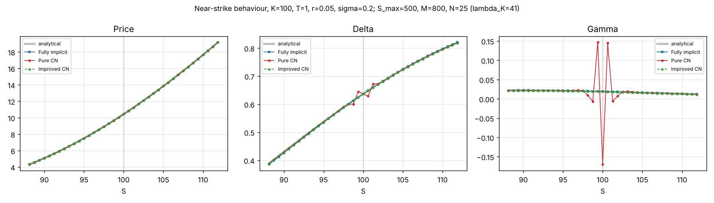
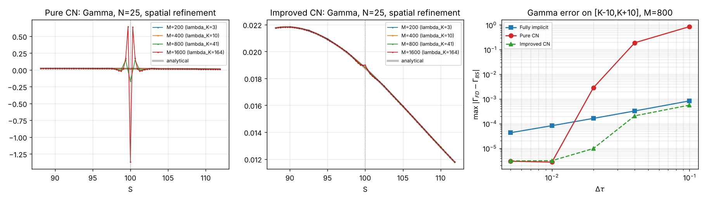

# Part 8 — The Payoff Kink, Crank–Nicolson Oscillations and Implicit Start-Up

> **Programs:** [`programs/payoff_kink_cn_oscillation.py`](../programs/payoff_kink_cn_oscillation.py), `startup` option of [`programs/crank_nicolson.py`](../programs/crank_nicolson.py)
> **Output:** [`results/09_payoff_kink_oscillation.txt`](../results/09_payoff_kink_oscillation.txt), [`figures/fig09_kink_price_delta_gamma.png`](../figures/fig09_kink_price_delta_gamma.png), [`figures/fig10_kink_refinement.png`](../figures/fig10_kink_refinement.png)

---

## 8.1 The problem

Crank–Nicolson is unconditionally stable and second-order accurate (Part 5), yet it is known to produce spurious oscillations at the strike, particularly in Delta and Gamma (Duffy, Ch. 15–16). This part answers four questions:

1. Why does the kink in $\max(S-K,0)$ cause oscillations in a *stable* scheme?
2. When do they appear, and how large are they for the professor's benchmark?
3. How does an implicit start-up remove them, and why does it not destroy second-order accuracy?
4. What does the improvement cost?

Three methods are compared on identical grids: **fully implicit**, **pure Crank–Nicolson**, and **improved Crank–Nicolson** (Rannacher start-up).

---

## 8.2 Regularity of the initial data

At $\tau = 0$,

$$
V(S,0) = \max(S-K,0), \qquad \frac{\partial V}{\partial S}(S,0) = H(S-K), \qquad \frac{\partial^2 V}{\partial S^2}(S,0) = \delta(S-K), \tag{8.1}
$$

where $H$ is the Heaviside step and $\delta$ the Dirac delta. The initial Gamma is infinite at the strike. For $\tau > 0$ the exact solution is smooth again (Gamma is the bell curve (7.2), with peak value growing like $1/(K\sigma\sqrt{\tau})$ as $\tau\to0$), so the difficulty is concentrated in the first moments of the time integration.

On the grid, with the strike on node $j_K$, the discrete second difference of the payoff is

$$
D_+D_- V_j^0 = \frac{1}{\Delta S}\,\delta_{j,j_K}, \tag{8.2}
$$

a single spike of height $1/\Delta S$. A spike contains **all** grid frequencies with comparable weight, including the highest one the grid can carry, the saw-tooth $(-1)^j$.

---

## 8.3 How each scheme treats the highest-frequency mode

Freeze the coefficients at the strike ($j = j_K = K/\Delta S$) and apply $\mathcal{L}_h$ to the saw-tooth $w_j = (-1)^j$:

$$
\mathcal{L}_h w_j = \alpha_j(-1)^{j-1} + \beta_j(-1)^j + \gamma_j(-1)^{j+1} = (\beta_j - \alpha_j - \gamma_j)\,w_j = -(2\sigma^2 j^2 + r)\,w_j .
$$

So the saw-tooth is (locally) an eigenmode with eigenvalue $\mu \approx -2\sigma^2 j_K^2$. With $z = \Delta\tau\,\mu$ define the **mode-damping parameter at the strike**

$$
\lambda_K = \frac{\sigma^2 K^2\,\Delta\tau}{(\Delta S)^2}, \qquad z \approx -2\lambda_K. \tag{8.3}
$$

The amplification factors (4.9) and (5.9) for this mode become

$$
G_{\text{BE}} = \frac{1}{1 + 2\lambda_K} \xrightarrow{\lambda_K\to\infty} 0, \qquad
G_{\text{CN}} = \frac{1 - \lambda_K}{1 + \lambda_K} \xrightarrow{\lambda_K\to\infty} -1. \tag{8.4}
$$

* For $\lambda_K < 1$, $0 < G_{\text{CN}} < 1$: the mode decays monotonically and CN behaves well.
* For $\lambda_K > 1$, $G_{\text{CN}} < 0$: the mode **changes sign at every step**. For $\lambda_K \gg 1$, $\lvert G_{\text{CN}}\rvert^N \approx e^{-2N/\lambda_K}$, so a fraction of the initial spike survives all $N$ steps.

This is the precise meaning of "A-stable but not L-stable" (Part 5): nothing grows, but stiff components are not damped. The surviving saw-tooth is tiny in the *price*, but by (7.6) it is divided by $\Delta S^2$ in Gamma. Since the spike (8.2) itself scales like $1/\Delta S$, the spurious Gamma behaves roughly like

$$
E_\Gamma^{\text{spurious}} \sim \frac{\lvert G_{\text{CN}}\rvert^N}{\Delta S}, \tag{8.5}
$$

which explains the two counter-intuitive facts measured below: **refining $\Delta S$ at fixed $\Delta\tau$ makes pure CN worse**, and the oscillation disappears only once $N$ is large enough that $\lambda_K$ is of order 1 or below. Equivalently, the CN right-hand matrix $B = I + \tfrac{\Delta\tau}{2}L_h$ has negative diagonal entries near the strike when $\lambda_K > 1$, so the discrete maximum principle is lost there.

The fully implicit method is L-stable: $G_{\text{BE}}$ kills the saw-tooth immediately, so it never oscillates, but it remains only first-order accurate in time.

---

## 8.4 The improved scheme: implicit (Rannacher) start-up

**Idea.** Use the strongly damping backward Euler method only while the data are non-smooth, then switch to Crank–Nicolson. Following the project plan (§8.13, "initial fully implicit substeps before switching to Crank–Nicolson") in Rannacher's form, the **first CN interval $[0,\Delta\tau]$ is replaced by two backward-Euler half-steps of length $\Delta\tau/2$**:

$$
\Big(I - \tfrac{\Delta\tau}{2}L_h\Big)\mathbf{V}^{1/2} = \mathbf{V}^0 + \mathbf{g}^{1/2}, \qquad
\Big(I - \tfrac{\Delta\tau}{2}L_h\Big)\mathbf{V}^{1} = \mathbf{V}^{1/2} + \mathbf{g}^{1}, \tag{8.6}
$$

$$
A\,\mathbf{V}^{n+1} = B\,\mathbf{V}^n + \mathbf{g}^{n,n+1}, \qquad n = 1,\dots,N-1 \quad\text{(ordinary CN, Part 5)}, \tag{8.7}
$$

with boundary values evaluated at $\tau = \Delta\tau/2$ and $\Delta\tau$ in (8.6). The time grid is unchanged; only the integrator on the first interval differs.

**Damping.** Over the first interval the saw-tooth is multiplied by

$$
G_{\text{start}} = \left(\frac{1}{1 + \lambda_K}\right)^2 \xrightarrow{\lambda_K\to\infty} 0, \tag{8.8}
$$

instead of $G_{\text{CN}} \to -1$. For the benchmark case below ($\lambda_K = 41$): $G_{\text{CN}} = -0.952$ per step, while the start-up factor is $5.7\times10^{-4}$.

**Why accuracy is preserved.** Backward Euler has local error $O(\Delta\tau^2)$ per step. It is used for a fixed number of steps (two half-steps) independent of $N$, so its total contribution to the global error is $O(\Delta\tau^2)$ — the same order as the CN global error. The scheme therefore remains second-order in time for smooth solutions, while acquiring L-stable damping exactly where the data are rough.

**Two vs four half-steps.** Using two half-steps (one interval) is Rannacher's original choice and the form adopted in this project; replacing the first *two* CN intervals by four half-steps (a variant analysed by Giles and Carter, 2006) damps intermediate frequencies more and is also tested below. The number of start-up steps is a stated methodological choice, not a free fitting parameter.

---

## 8.5 Experiments and results

All runs: benchmark $K = 100$, $T = 1$, $r = 0.05$, $\sigma = 0.20$, $S_{\max} = 500$, call. Errors are max-norms over the strike window $[K-10, K+10]$; "spurious extrema" as defined in Part 7.

### (a) An oscillating regime: $M = 800$, $N = 25$ ($\Delta S = 0.625$, $\Delta\tau = 0.04$, $\lambda_K = 41$)

| Method | $\lvert V(K)$ err$\rvert$ | $E_V$ | $E_\Delta$ | $E_\Gamma$ | $\Gamma(K)$ | min $\Gamma$ | spurious extrema |
|---|---:|---:|---:|---:|---:|---:|---:|
| Fully implicit | 4.29e-02 | 4.37e-02 | 3.59e-03 | 3.25e-04 | 0.01908 | 0.0130 | 0 |
| Pure CN | 2.29e-02 | 2.29e-02 | 1.95e-02 | **1.89e-01** | **−0.17017** | **−0.170** | **8** |
| Improved CN | **1.44e-03** | 1.44e-03 | 7.06e-05 | 2.06e-04 | 0.01897 | 0.0129 | 0 |

(Analytical $\Gamma(K) = 0.018762$.) Pure CN produces a **negative Gamma at the strike**, about ten times the true value in magnitude, and a zig-zag Delta — a numerical artefact, since a European call is convex. The price error of pure CN looks unremarkable ($2.3\times10^{-2}$), illustrating *price accuracy $\not\Rightarrow$ Greek accuracy*. The start-up removes the oscillation completely and also gives the smallest price error of the three methods (16× smaller than pure CN, 30× smaller than fully implicit).

### (b) Effect of the time step ($M = 800$ fixed)

| $N$ | $\lambda_K$ | $G_{\text{CN}}$ | Implicit $E_\Gamma$ | Pure CN $E_\Gamma$ | Pure CN $\Gamma(K)$ | Improved CN $E_\Gamma$ |
|---:|---:|---:|---:|---:|---:|---:|
| 10 | 102.4 | −0.981 | 8.32e-04 | 8.51e-01 | 0.86963 | 5.60e-04 |
| 25 | 41.0 | −0.952 | 3.25e-04 | 1.89e-01 | −0.17017 | 2.06e-04 |
| 50 | 20.5 | −0.907 | 1.62e-04 | 2.83e-03 | 0.02159 | 9.73e-06 |
| 100 | 10.2 | −0.822 | 8.23e-05 | 2.74e-06 | 0.01876 | 3.13e-06 |
| 200 | 5.1 | −0.673 | 4.26e-05 | 2.97e-06 | 0.01876 | 3.07e-06 |

Pure CN needs $N \ge 100$ on this grid before its Gamma is trustworthy; the improved scheme is accurate from $N = 50$ on and never oscillates. Once the oscillation has died out ($N \ge 100$) pure and improved CN agree, confirming that the start-up does not degrade the asymptotic accuracy. The fully implicit Gamma error halves with each halving of $\Delta\tau$ (first order).

### (c) Effect of spatial refinement ($N = 25$ fixed)

| $M$ | $\Delta S$ | $\lambda_K$ | Implicit $E_\Gamma$ | Pure CN $E_\Gamma$ | Pure CN $\Gamma(K)$ | spurious ext. | Improved CN $E_\Gamma$ | spurious ext. |
|---:|---:|---:|---:|---:|---:|---:|---:|---:|
| 200 | 2.5 | 2.6 | 3.73e-04 | 4.38e-05 | 0.01880 | 0 | 5.01e-05 | 0 |
| 400 | 1.25 | 10.2 | 3.34e-04 | 1.39e-03 | 0.01738 | 6 | 2.85e-05 | 0 |
| 800 | 0.625 | 41.0 | 3.25e-04 | 1.89e-01 | −0.17017 | 8 | 2.06e-04 | 0 |
| 1600 | 0.3125 | 163.8 | 3.22e-04 | 1.39e+00 | −1.37203 | 8 | 2.38e-04 | 2 |

Refining the space grid at fixed $\Delta\tau$ makes pure CN **diverge** in Gamma, exactly as (8.5) predicts. With the start-up the error stays small; at the extreme $\lambda_K = 164$ two small residual wiggles remain, because the two half-steps damp the very highest modes ($G_{\text{start}} \approx 4\times10^{-5}$) but intermediate frequencies less strongly.

### (d) Start-up variant ($M = 800$)

| $N$ | start-up | $\lvert V(K)$ err$\rvert$ | $E_\Delta$ | $E_\Gamma$ |
|---:|---|---:|---:|---:|
| 10 | 2 half-steps (Rannacher) | 3.33e-03 | 3.68e-04 | 5.60e-04 |
| 10 | 4 half-steps | 9.03e-03 | 6.21e-04 | 5.31e-05 |
| 25 | 2 half-steps (Rannacher) | 1.44e-03 | 7.06e-05 | 2.06e-04 |
| 25 | 4 half-steps | 2.25e-03 | 1.29e-04 | 1.06e-05 |

Four half-steps reduce the Gamma error by a further factor of 10–20 at the price of a somewhat larger price and Delta error (more first-order steps). Neither variant shows spurious extrema here. The project's "improved CN" uses the two-half-step procedure; the comparison is reported so the trade-off is visible.

### (e) Cost ($M = 800$, $N = 25$)

| Method | tridiagonal solves | run time |
|---|---:|---:|
| Fully implicit | 25 | ≈ 7–8 ms |
| Pure CN | 25 | ≈ 7–8 ms |
| Improved CN | 26 | ≈ 7–8 ms |

The start-up adds a single tridiagonal solve; the difference in run time is within measurement noise.

---

## 8.6 Conclusions

1. The kink makes the initial Gamma a spike containing the highest grid frequencies. CN's amplification factor tends to $-1$ for these modes, so they survive as sign-alternating errors when $\lambda_K = \sigma^2K^2\Delta\tau/\Delta S^2 \gg 1$.
2. These errors are negligible in the price but dominate Gamma (division by $\Delta S^2$); refining $\Delta S$ alone makes them worse.
3. Fully implicit Euler never oscillates (L-stable) but is only first-order accurate.
4. Replacing the first CN interval by two backward-Euler half-steps damps the stiff modes by $(1+\lambda_K)^{-2}$, removes the oscillations at negligible cost and keeps second-order accuracy — the improved CN is the most accurate of the three methods for price, Delta and Gamma in every oscillating case tested.
5. On the moderate grids of Parts 6–7 ($\lambda_K \le 5$) all three methods are oscillation-free; the start-up matters when $\Delta\tau$ is coarse relative to $\Delta S^2$, which is precisely the regime in which Crank–Nicolson would otherwise be chosen for efficiency.

---

## 8.7 Implementation

| Equation | Code |
|---|---|
| (8.6) half-steps | `implicit_step(..., 0.5 * dt, ...)` called twice inside `crank_nicolson_solver(..., startup=1)` |
| (8.7) CN steps | `cn_step` in `crank_nicolson.py` |
| (8.3), (8.4), (8.8) | `lam(...)` and the printed factors in `payoff_kink_cn_oscillation.py` |
| experiments (a)–(e) | sections `[1]`–`[5]` of `payoff_kink_cn_oscillation.py` |

The regime can be explored directly, e.g. `python payoff_kink_cn_oscillation.py --M 1600 --N 50` or `python crank_nicolson.py --M 800 --N 25 --startup 1`.
